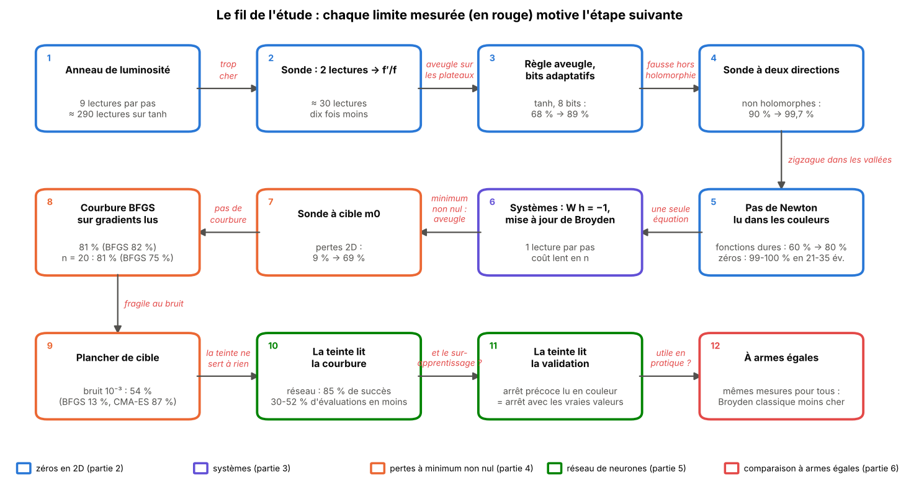
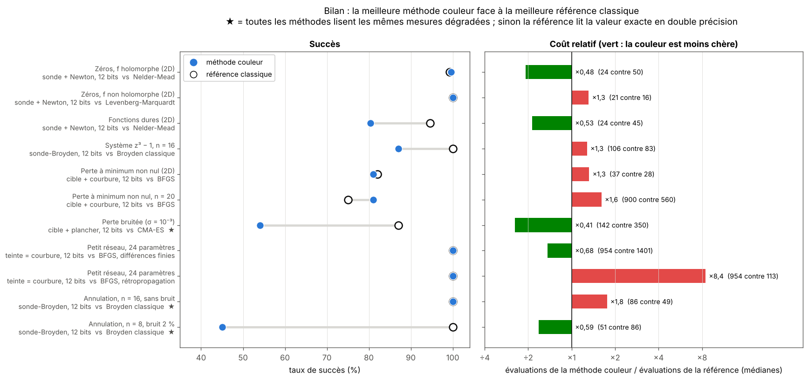
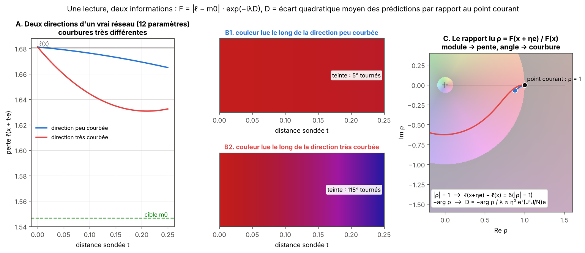
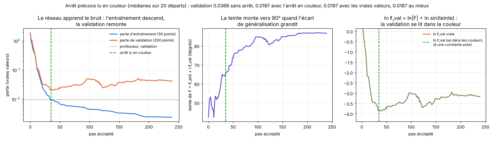

# Optimizing with colors

*complex-colorimetry-optimization*

🇬🇧 English · 🇫🇷 [Version française](README.fr.md)

**Can you find the zeros of a function, or minimize a loss, by looking only at the colors of its *domain coloring*?**

The rule of the game: the algorithm never reads the value of `f`. It only sees a color, quantized to 8 or 12 bits per channel. The **hue** gives the argument of `f`; the **brightness** gives `log|f|` to within one decade. I start from the most naive algorithm ("move toward the darkest neighbor"), improve it limit after limit, and at every step compare it with classical methods (Newton, BFGS, Nelder-Mead, CMA-ES, Adam…) at **equal evaluation cost**.

**Short answer.**
- **Finding zeros works very well.** Two color readings are enough for a full Newton step, because the moduli cancel out. With an 8-bit sensor, the method finds zeros as often as the best classical methods, often with fewer evaluations.
- **Minimizing an ordinary loss needs two more ideas**: a target that is lowered along the way, then a learned curvature. The method then reaches BFGS's success rate up to dimension 20, at 1.2 to 2 times its cost.
- **The hue can carry a second piece of information for free.** On a small neural network it reads the curvature (−30 to −52 % evaluations) or the validation loss (early stopping read from the color).
- **On equal terms, no advantage.** When classical methods receive exactly the same degraded measurements, classical Broyden stays cheaper and the probe is more fragile to noise.

> **Language note.** This page is in English; the detailed write-ups of each part (`parties/`), the pitfalls (`fausses-pistes/`) and the ideas list are in French, and the text inside the figures is in French. The numbers and tables are self-explanatory.

## The idea in four pictures

**1. The sensor.** Every point gets a color. The hue gives `arg f`; the brightness is a sawtooth with one tooth per decade of `|f|`. The sensor never gives the value of `f`.


**2. Why color shows the way.** For a holomorphic function, lines of equal hue cross lines of equal `|f|` at right angles (Cauchy-Riemann). Descending `|f|` means following a line of constant hue down to the zero.


**3. From the ring to the probe.** The naive algorithm reads 9 colors around the point and moves toward the darkest. But the color difference between **two** points directly gives `L = ln f(z+η) − ln f(z) ≈ η·f'/f`: the brightness change is its real part, the hue change its imaginary part. From it we get the direction **and** the length of the Newton step, `h = −f/f'`.


**4. A real descent** with the 8-bit sensor: each step costs two readings and divides `|f|` by a roughly constant factor.


## The thread of the study

Each step comes from a measured limit of the previous one.



## The results in one chart

For each situation, the best color method against the best classical reference. Success on the left, relative cost on the right.



One caveat: except for the rows marked ★, the reference reads the **exact value** of `f` in double precision, while the probe reads a quantized sensor. Part 6 is the only comparison where everybody reads the same measurements.

| situation | verdict | key figures | part |
|---|---|---|---|
| zeros of holomorphic functions (C → C) | **very good** | 99-100 % in 24-35 evaluations; Nelder-Mead 99 % in 50, BFGS 99 % in 43 | [2](parties/2_zeros_en_2d/) |
| zeros of non-holomorphic functions (two-direction probe) | **very good** | 99.8-100 % in 21-30 evaluations | [2](parties/2_zeros_en_2d/) |
| narrow valleys, ill-conditioning (Newton step read from colors) | good | Rosenbrock 0 % → 79-99 %; hard functions 80 % (Nelder-Mead 95 %) | [2](parties/2_zeros_en_2d/) |
| coarse sensor, change of scale | good | 91-97 % from 6 bits; scale-invariant from 10⁻¹² to 10¹² | [2](parties/2_zeros_en_2d/) |
| systems of n equations (Broyden probe) | good | cost grows slowly in n; beats finite-difference Newton, LM and BFGS from n ≈ 8, **not** classical Broyden | [3](parties/3_systemes_dimension_n/) |
| black box, against general derivative-free methods | wins | linear system, n = 16: 100 % in 48 readings; Nelder-Mead, Powell, CMA-ES: 0 % | [3](parties/3_systemes_dimension_n/) |
| loss with nonzero minimum | fails, then **fixed** | base probe 9 % → target 69 % → target + curvature 81 % (BFGS 82 %); n = 20: 81 % (BFGS 75 %) at 1.2-2× its cost | [4](parties/4_pertes_minimum_non_nul/) |
| noisy loss | limited | the most robust gradient-based method (54 % vs 13 % for BFGS at 0.1 % noise), far behind CMA-ES (87 %) | [4](parties/4_pertes_minimum_non_nul/) |
| small neural network, hue reads curvature | good as a black box | 85 % (finite-difference BFGS: 84 %), 30-52 % fewer evaluations; backprop BFGS stays 6-18× cheaper | [5](parties/5_reseau_de_neurones/) |
| hue reads the validation loss | **works** | early stopping read from color = early stopping with true values (validation 0.0197 vs 0.0368 without stopping) | [5](parties/5_reseau_de_neurones/) |
| multimodal functions (Rastrigin) | fails | falls into local basins, like any descent method | [2](parties/2_zeros_en_2d/), [4](parties/4_pertes_minimum_non_nul/) |
| **same degraded measurements for all** | no advantage | classical Broyden cheaper; probe fragile from 2 % noise for n ≥ 8 | [6](parties/6_a_armes_egales/) |

## What the hue adds

As long as we minimize a real loss, the hue is useless: we read the color of a real number. But a color reading gives a **complex ratio**, i.e. the variation of two quantities for the price of one. Reading `F = |ℓ − m0|·exp(−iλD)`, where `D` is the distance between the network's predictions and those at the current point, the brightness reads the slope and the hue reads the Gauss-Newton curvature along the probed direction:



With `F = ℓ_train·exp(i·ln ℓ_val)`, the hue tracks the validation loss, and early stopping can be decided by looking at the color:



## What is new, and what is not

Every building block is known: Newton on `ln f`, Broyden's method, the Polyak step with a target value (1969), BFGS, noise-adapted finite differences. Following the color, the study **rediscovers** them one by one. What seems specific to this work:
- color as the only sensor, and measuring what it costs against classical methods;
- the target `m0`, which not only sets the step but above all **makes the signal readable** near the minimum;
- the hue as a second channel (curvature, validation) in the same reading as the slope.

References and positioning: [`docs/REFERENCES.md`](docs/REFERENCES.md) (French).

## Walkthrough

1. [**Sensor and probe**](parties/1_capteur_et_sonde/): the sensor, the exploration GUI, the rings, the theorems (Cauchy-Riemann, argument principle, minimum modulus), then the two-reading probe.
2. [**Zeros in 2D**](parties/2_zeros_en_2d/): each limit leads to an improvement (plateaus → blind rule, non-holomorphy → two directions, valleys → Newton step, cost → adaptive probe and adaptive bits). Main benchmark on 5 seeds.
3. [**Systems in dimension n**](parties/3_systemes_dimension_n/): `W h = −1`, reusing readings (Broyden probe), adaptive bits, and the black-box comparison.
4. [**Losses with a nonzero minimum**](parties/4_pertes_minimum_non_nul/): the base probe fails; target, curvature, cost diagnosis, dimension n, noise.
5. [**Neural network**](parties/5_reseau_de_neurones/): the target probe on a small network, then the hue at work (curvature, validation).
6. [**On equal terms**](parties/6_a_armes_egales/): a cancellation problem with a gain/phase detector, same measurements for every method.

Alongside: [**dead ends**](fausses-pistes/) (what did not work, and why) and [**ideas to explore**](IDEES_A_EXPLORER.md).

## Repository layout

```
README.md / README.fr.md   this page (English) / French version
IDEES_A_EXPLORER.md        ideas for going further
docs/REFERENCES.md         references and positioning
schemas/                   14 diagrams (make_schemas.py, make_syntheses.py)
src/                       shared code: sensor, probes, Tkinter GUI
parties/
  1_capteur_et_sonde/      text, GUI screenshots, notebooks, tanh tests
  2_zeros_en_2d/           2D benchmarks (comparison, non-holomorphic, hard, final 5-seed run, sensitivity, bits)
  3_systemes_dimension_n/  benchmarks in Cⁿ and black-box
  4_pertes_minimum_non_nul/ target probe, curvature, cost, dimension n, noise
  5_reseau_de_neurones/    small student-teacher network, hue = curvature, hue = validation
  6_a_armes_egales/        gain/phase detector, same measurements for all
fausses-pistes/            discarded attempts, with scripts and results
```

In each part, `bench_*.py` runs a benchmark and writes `*_results.json`; `bench_*_figs.py` builds the tables (`*_tables.md`) and figures (`figures/`).

## Run it

```
pip install -r requirements.txt
python src/color_descent_gui.py                    # exploration GUI (Tkinter)
python parties/2_zeros_en_2d/bench2d.py --smoke    # quick check of one benchmark
python schemas/make_schemas.py                     # regenerates diagrams 1 to 11
python schemas/make_syntheses.py                   # regenerates diagrams 12 to 14
sh run_long.sh                                     # recompute everything (≈ 2 h)
```

## Limits

- Five start seeds for part 2, a single one for parts 3 to 6.
- Test functions chosen by me: they cover classical cases, not real industrial problems.
- Outside part 6, classical methods read the exact value of `f`: the comparison favors them on this point, but it does not tell what they would do with an equally poor sensor.
- Non-systematic literature review.

## License

Code: [MIT](LICENSE). Text, diagrams and figures: [CC BY 4.0](LICENSE-CONTENT.md). © Mathis Frinzi, [github.com/mathisfrinzi](https://github.com/mathisfrinzi).
