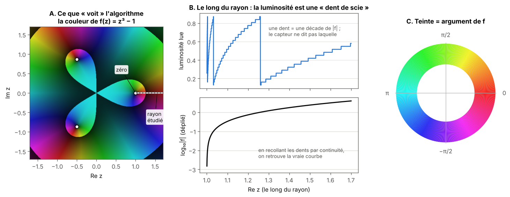
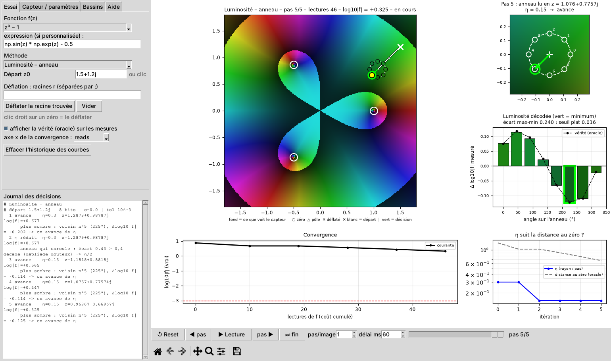
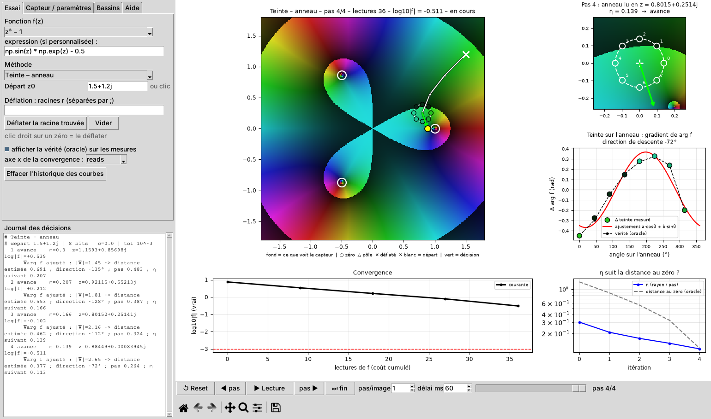
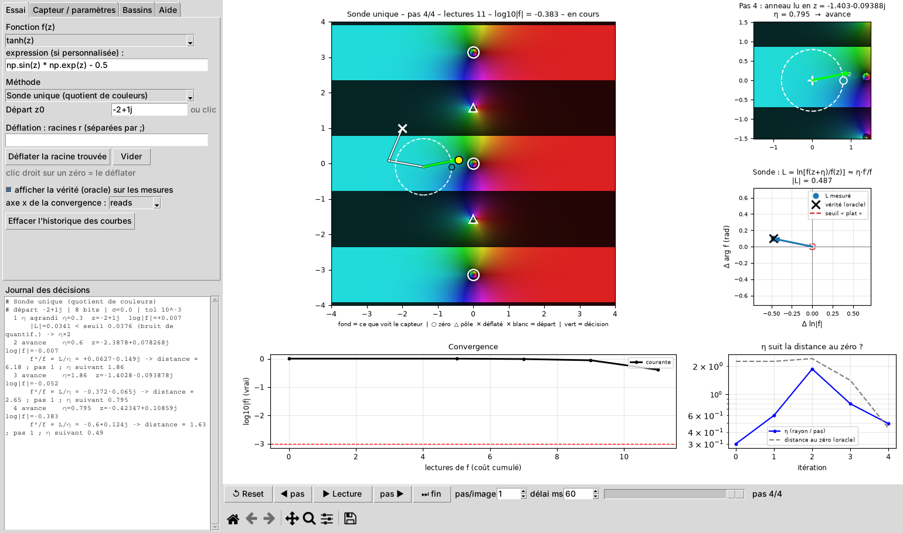
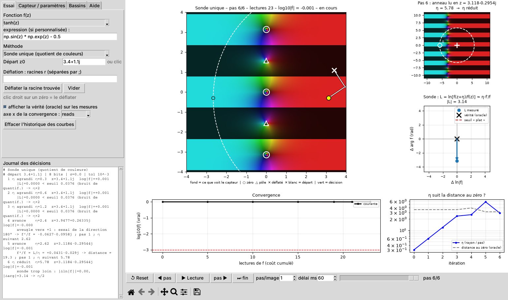
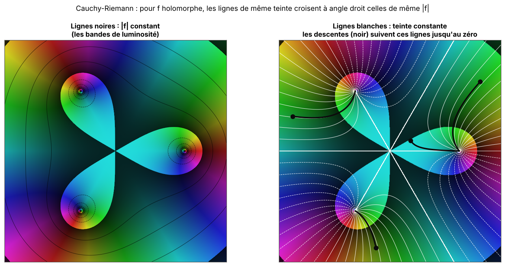
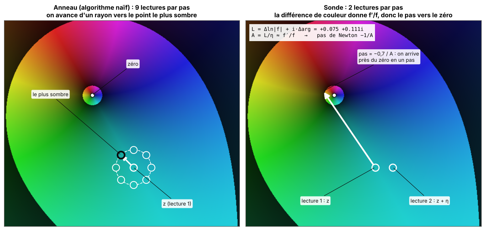
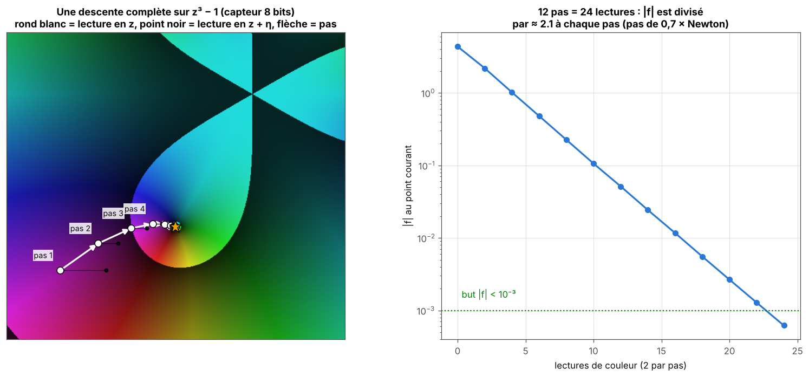
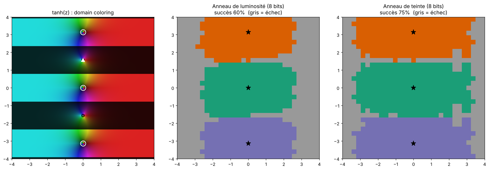

# Partie 1 : l'idée, l'exploration, les anneaux, les théorèmes, la sonde

> **En bref.** La couleur d'un domain coloring donne `arg f` (teinte) et `ln|f|` à une décade près (luminosité). Un algorithme naïf qui va vers le plus sombre marche (98-100 % sur tanh) mais coûte ~290 lectures. Pour une fonction holomorphe, deux lectures suffisent à obtenir `f'/f`, donc la direction et même le pas de Newton : c'est la **sonde**, environ dix fois moins chère.

## 1.1 Question de départ

On se demande s'il est possible d'optimiser avec **les couleurs d'un domain coloring et rien d'autre**. On part d'un algorithme naïf, qui suit la luminosité, et on cherche à l'améliorer autant que possible.

Cadre : `f : C → C` holomorphe, un point `z`, et le but est de trouver un zéro de `f`, c'est-à-dire le minimum de `|f|`. On suppose qu'à une distance `η` autour de `z` il y a des points plus sombres (proches du minimum) et plus clairs (loin du minimum) ; on lit les couleurs autour de `z` et on les suit.

## 1.2 Le capteur

Le capteur transforme la valeur `f(z)` en une couleur RGB quantifiée sur `b` bits par canal (8 par défaut) :

- **teinte** = `arg f(z) / 2π` ;
- **luminosité** = `0,14 + 0,72 · frac(log10 |f(z)|)` : des bandes sombres/claires marquent les décades de `|f|` ;
- le capteur ne donne donc que `arg f` et `ln|f|` modulo `ln 10`. Le module absolu est perdu et se retrouve seulement en « dépliant » les bandes par continuité.

*A : la couleur de `z³ − 1`. B : le long du rayon pointillé, la luminosité lue fait une dent par décade de `|f|` ; en recollant les dents on retrouve `log₁₀|f|`. C : la roue des teintes.*

## 1.3 Exploration : l'interface

L'interface Tkinter (`src/color_descent_gui.py`) montre : le paysage coloré, ce que lit réellement le capteur, la décision à chaque pas (avec journal), l'anneau lu zoomé, la convergence, et la comparaison à une descente exacte et à Newton. Les captures ci-dessous sont produites par `make_screens.py`.

## 1.4 L'algorithme naïf : l'anneau de luminosité

À chaque pas : lecture de la couleur en `z` et en `K = 8` points d'un anneau de rayon `η`. La luminosité est dépliée par rapport à la valeur précédente (pour lever l'ambiguïté de bande). On avance vers le voisin le plus sombre. Si l'anneau « enroule » (écart de plus de 0,4 décade), on divise `η` par 2 ; s'il est plat (écart sous 3 niveaux de quantification), on multiplie `η` par 2 ; si aucun voisin n'est plus sombre, on divise `η` par 2.

Coût : `K + 1 = 9` lectures par pas. Sur tanh (961 départs) l'algorithme réussit 98 % (8 bits) et 100 % (12 bits), pour environ 290 lectures médianes.

## 1.5 L'anneau de teinte et les théorèmes qui justifient la couleur

- **Cauchy-Riemann.** Pour `f` holomorphe, les lignes de même teinte (isochromes) sont les lignes de plus grande pente de `|f|`, et `|∇ arg f| = |∇ ln|f|| = |f'/f| ≈ 1/(distance au zéro)`. La teinte seule donne donc la **direction de descente** et une **estimation de la distance** : l'anneau de teinte ajuste `arg f ≈ a cosθ + b sinθ` et avance dans la direction `(−b, a)`.
- **Principe de l'argument.** Le nombre de zéros dans un disque est le nombre de tours de la teinte le long du bord. Exact ou quasi exact (au moins 99,7 %) dès 32 points de contour dans mes tests, presque quel que soit le nombre de bits.
- **Principe du minimum du module.** Une `f` holomorphe non constante n'a pas de minimum local de `|f|` autre qu'un zéro : pas de minimum local parasite. C'est ce qui disparaît hors holomorphie (partie 2).
- **Règle du produit.** `(fg)'/(fg) = f'/f + g'/g` : les teintes s'ajoutent et les `ln|·|` aussi. La **déflation** d'une racine déjà trouvée (diviser `f` par `z − r`) se fait sur les lectures, sans évaluer `f` de plus.
- **Invariance d'échelle.** Descendre `ln|f|` avec un pas normalisé est invariant par `f → s·f`. Cela vient de `log` et du pas normalisé, pas de la couleur seule : une descente de gradient classique sur `|f|²` ne marche que pour l'échelle où son pas est réglé.

*Les lignes de même teinte (blanc) croisent à angle droit les lignes de même `|f|` (noir) ; une descente de `|f|` suit une ligne de teinte constante jusqu'au zéro.*

## 1.6 La sonde unique

Pour `f` holomorphe, `f'/f` est **le même dans toutes les directions** : un anneau de 8 points est redondant. Deux lectures suffisent : en `z` et en `z + η`. Le quotient `f(z+η)/f(z)` s'obtient par différence des couleurs :

`L = ln f(z+η) − ln f(z) ≈ η f'/f` (un nombre complexe : partie réelle = variation de `ln|f|`, partie imaginaire = variation de l'argument).

Descente de `ln|f|` : direction `−conj(f'/f)`, pas normalisé `min(0,7 / |f'/f|, 1)`, et `η` suivant `0,3 / |f'/f|`. Garde-fous : si `|Δ ln|f||` dépasse 0,4 décade ou `|Δ arg|` dépasse 0,8π, la sonde a enjambé une bande ou un tour, on divise `η` par 2 ; si `|L|` est sous le seuil de quantification, on agrandit `η`.

Coût : 2 lectures par pas. Sur tanh la sonde fixe réussit 68 % (8 bits) et 85 % (12 bits) pour 28 à 32 lectures médianes : environ dix fois moins que l'anneau de luminosité, mais elle échoue plus souvent sur le plateau de tanh (partie 2, règle « aveugle »).

*À gauche, l'anneau lit 9 couleurs et avance d'un rayon vers la plus sombre. À droite, la sonde lit 2 couleurs ; leur différence `L` donne `A ≈ f'/f`, et le pas `−0,7/A` arrive presque sur le zéro.*

*Une descente réelle avec le capteur 8 bits : chaque pas coûte deux lectures et divise `|f|` par un facteur à peu près constant.*

## 1.7 État de l'art (vérification limitée)

*Revue plus complète, partie par partie : [`docs/REFERENCES.md`](../../docs/REFERENCES.md).*

Deux recherches rapides n'ont pas trouvé de travail qui utilise la couleur comme **seul capteur** d'un algorithme d'optimisation. Cela ne prouve pas que l'idée soit nouvelle : une revue systématique reste à faire avant de l'affirmer. Ce qui existe et qui compte pour le contexte :

- le **flot de Newton continu** et sa structure pour les fonctions méromorphes : Jongen, Jonker, Twilt, [*The continuous, desingularized Newton method for meromorphic functions*, Acta Applicandae Mathematicae (1988)](https://ris.utwente.nl/ws/files/18474443/Jongen_10.1007_BF00047503.pdf). Les trajectoires de la descente de `ln|f|` sont celles du flot de Newton ;
- le **domain coloring** et les portraits de phase comme outil d'analyse : [Wegert, *Visual Exploration of Complex Functions*](https://math.okstate.edu/people/scurry/5283/sp21/17_Wegert2016_Chapter_VisualExplorationOfComplexFunctions.pdf), et [une introduction au domain coloring](https://math.libretexts.org/Bookshelves/Analysis/Complex_Analysis_-_A_Visual_and_Interactive_Introduction_(Ponce_Campuzano)/03%3A_Chapter_3/3.04%3A_Domain_coloring) ;
- les méthodes de recherche de racines simultanées de type Aberth-Ehrlich, dont l'idée de déflation par produit est voisine.

## 1.8 Ce que la partie 1 établit, et ses limites

- La couleur contient assez d'information pour descendre vers un zéro avec un capteur de 8 bits.
- Une lecture unique de deux points (sonde) remplace l'anneau pour une fonction holomorphe, pour un coût environ dix fois plus faible.
- Les résultats de cette partie sont sur un petit nombre de fonctions et une seule grille de départs ; la partie 2 les rassemble avec plusieurs graines.

## Fichiers

- `notebooks/` : le premier banc (`benchmark_descente_par_couleurs.ipynb`) et ses extensions (`extensions_descente_par_couleurs.ipynb`, produit par `build_nb.py`) ;
- `make_screens.py` : captures de l'interface ; `tanh_test.py`, `probe_variants.py` : anneaux et sonde sur tanh ; `test_regression.py` : tests de non-régression.
