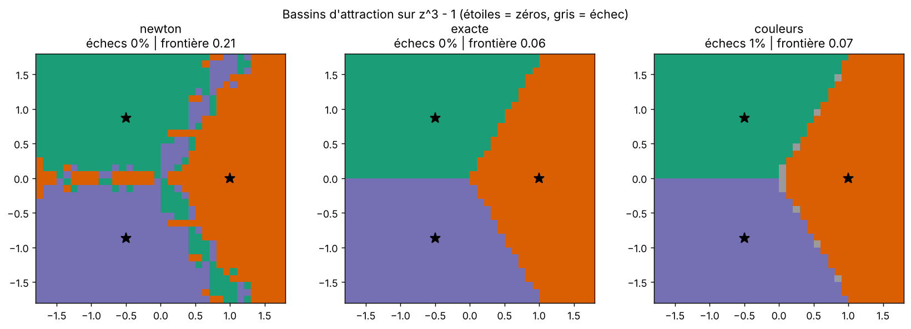
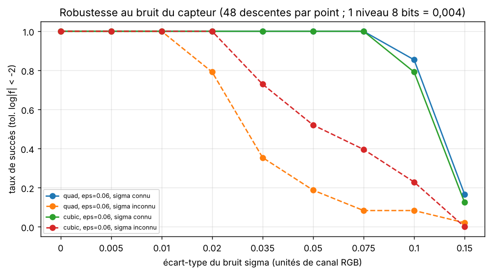
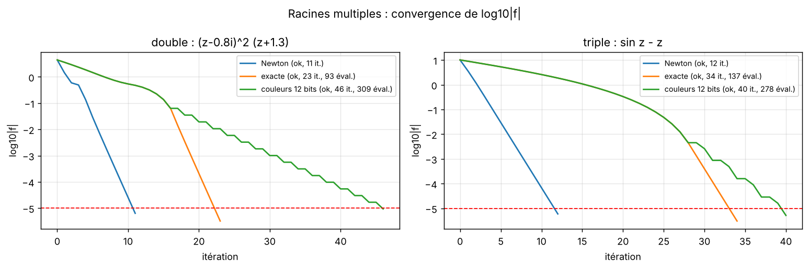
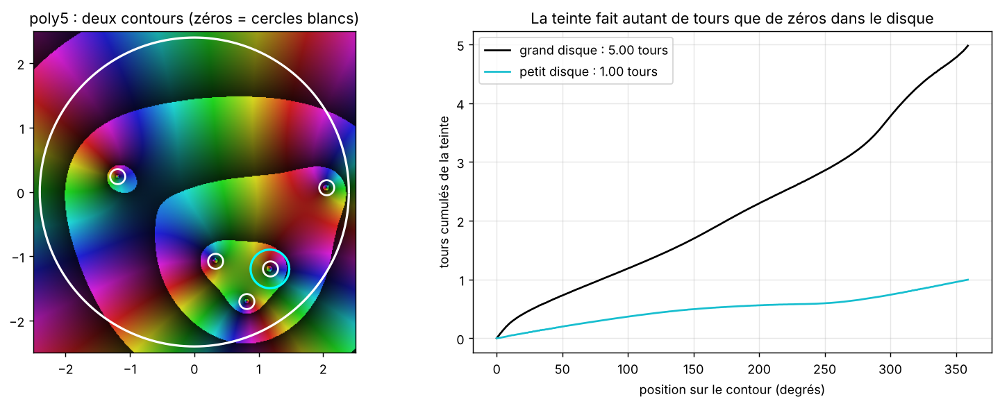
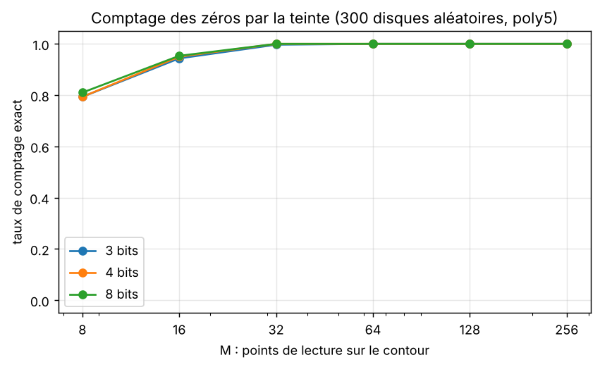
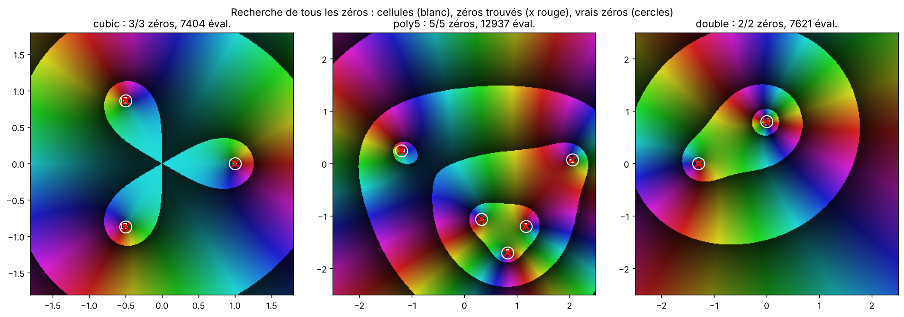
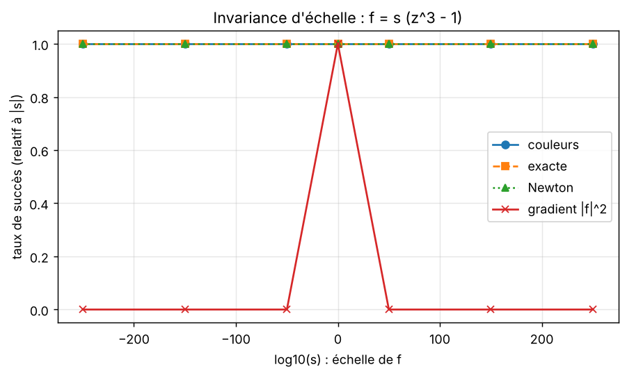

# Descente de gradient « par couleurs » dans le plan complexe

Premières expériences, faites avec une descente de gradient sur la luminosité (avant la sonde). L'idée étudiée : chercher les zéros
d'une fonction analytique `f` en n'utilisant **que la couleur** d'un *domain coloring* :

- **teinte** = `arg f(z)` ;
- **luminosité** = `0,14 + 0,72 × frac(log10 |f(z)|)` (des bandes sombres marquent `|f| = 10^k`), lue sur un capteur quantifié (8 bits par canal par défaut).

Le notebook `notebooks/extensions_descente_par_couleurs.ipynb` (Colab, ~3 min) contient 6 expériences, déjà exécutées. Les figures sont dans `figures/`, les chiffres bruts dans `results.json`.

## Ce que montre cette première version

**Comme méthode de recherche de racines, cette descente de gradient n'est pas compétitive.** Quand `f` est calculable, Newton est plus rapide (expérience 3) et la descente par couleurs coûte plus d'évaluations que la descente exacte. Ce que le capteur couleur apporte est ailleurs :

1. la **teinte** donne un comptage de zéros par le principe de l'argument (exp. 4), et donc une recherche de *tous* les zéros sans point de départ (exp. 5) ;
2. une descente qui ne dépend que d'un capteur **quantifié et bruité** reste fiable (exp. 1 et 2) ;
3. l'encodage par `log|f|` donne une **invariance d'échelle** (exp. 6), même si ce n'est pas propre à la couleur.

C'est ce qui a conduit à la sonde (section 1.6 du README), qui lit le pas de Newton dans les couleurs et change ce verdict (partie 2).

## Défauts de la première descente, et leurs corrections

Le premier benchmark (`notebooks/benchmark_descente_par_couleurs.ipynb`) avait plusieurs défauts, corrigés dans le notebook d'extensions :

| Problème | Correction |
|---|---|
| Pas fixe : la descente oscille à distance ~`alpha` du zéro et n'atteint jamais la tolérance | backtracking sur la luminosité décodée |
| Écart `eps` fixe : la différence centrée enjambe le zéro près de la racine et la descente cycle (surtout sur une racine double) | `eps = min(eps, pas/2)` |
| Pas trop grand près du zéro | plafond `pas <= 1/‖∇ ln|f|‖`, estimation de la distance au zéro **tirée de la couleur** (`cap=True`) |
| Plancher de pas `1e-4` : arrêt vers `|f| ~ 1e-3` alors que la descente progressait encore | plancher à `1e-8` |
| Rendu : tout `|f| < 1e-12` devenait « noir » (contredit l'invariance d'échelle) | seuil à `1e-290` |
| Capteur image : la moyenne 3x3 des couleurs mélange des pixels de part et d'autre d'une frontière de bande | lecture du pixel le plus proche |

**Ablation du plafond de pas** (16 départs, capteur 8 bits, tolérance `log|f| < -3`) :

| fonction | succès sans / avec | itérations sans / avec | évaluations sans / avec |
|---|---|---|---|
| quad | 94 % / 100 % | 49,8 / 31,4 | 397 / 213 |
| cubic | 100 % / 100 % | 42,3 / 28,9 | 281 / 194 |
| poly5 | 100 % / 100 % | 59,0 / 37,5 | 393 / 253 |
| double | 100 % / 100 % | 27,7 / 31,0 | 189 / 211 |
| sinz | 100 % / 100 % | 45,5 / 44,0 | 318 / 309 |

Le plafond réduit les itérations et les évaluations de 30 à 45 % sur les racines simples ; il n'apporte rien (légère perte sur `double`) sur les racines multiples.

## Expérience 1 : bassins d'attraction

Une descente depuis chaque point d'une grille 36×36 sur `z³ - 1`. Un départ est compté comme réussi s'il finit à moins de 0,02 d'une racine (précision du capteur).



| méthode | échecs | longueur de frontière (fraction de pixels voisins différents) |
|---|---|---|
| Newton | 0 % | 0,21 |
| exacte | 0 % | 0,06 |
| couleurs | 0,8 % | 0,07 |

Les descentes sur `log|f|` donnent des bassins lisses, alors que Newton donne les bassins fractals attendus. La descente par couleurs reproduit presque exactement la descente exacte malgré le capteur 8 bits.

## Expérience 2 : capteur bruité

Bruit gaussien d'écart-type `sigma` ajouté à chaque canal RGB (un niveau 8 bits = 0,004). « Connu » : la marge du backtracking tient compte de `sigma` ; « inconnu » : marge de quantification seule. 48 descentes par point, tolérance `log|f| < -2`.



| sigma | quad connu | quad inconnu | cubic connu | cubic inconnu |
|---|---|---|---|---|
| 0,01 | 100 % | 100 % | 100 % | 100 % |
| 0,02 | 100 % | 79 % | 100 % | 100 % |
| 0,035 | 100 % | 35 % | 100 % | 73 % |
| 0,05 | 100 % | 19 % | 100 % | 52 % |
| 0,075 | 100 % | 8 % | 100 % | 40 % |
| 0,10 | 85 % | 8 % | 79 % | 23 % |
| 0,15 | 17 % | 2 % | 12 % | 0 % |

Connaître le niveau de bruit repousse la limite de `sigma` ≈ 0,02 à ≈ 0,075-0,10 (plus de 10 niveaux 8 bits). Sans cette connaissance, la limite est autour de 0,02-0,035 selon la fonction (quelques niveaux 8 bits).

## Expérience 3 : racines multiples

Racine double `(z - 0,8i)²(z + 1,3)` et racine triple `sin z - z`, capteur 12 bits, tolérance `log|f| < -5`.



| | Newton | exacte | couleurs 12 bits |
|---|---|---|---|
| double : itérations (évaluations) | 11 | 23 (93) | 46 (309) |
| triple : itérations (évaluations) | 12 | 34 (137) | 40 (278) |

**La descente n'est pas plus rapide que Newton sur les racines multiples.** Newton y perd sa convergence quadratique (elle devient linéaire) mais ne diverge pas, et reste plus rapide.

## Expérience 4 : la teinte compte les zéros

Principe de l'argument : le nombre de zéros dans un disque est le nombre de tours de `arg f` le long du contour. On le mesure sur la teinte lue (quantifiée) en `M` points.



Sur 10 cas (racines simples, double, triple), le comptage est exact 10 fois sur 10 avec `M = 256`. Précision sur 300 disques aléatoires de `poly5`, en fonction du nombre de points :



| M | 8 | 16 | 32 | 64 | 128 | 256 |
|---|---|---|---|---|---|---|
| 3 bits | 79,3 % | 94,3 % | 99,7 % | 100 % | 100 % | 100 % |
| 4 bits | 79,3 % | 95,0 % | 100 % | 100 % | 100 % | 100 % |
| 8 bits | 81,0 % | 95,3 % | 100 % | 100 % | 100 % | 100 % |

Dès 32 points par contour, le comptage est (quasi) exact, et la quantification en bits n'a presque aucun effet : seule la **teinte** compte ici, pas la finesse de la luminosité. Les disques dont le contour passe à moins de 0,05 d'un zéro sont exclus.

## Expérience 5 : trouver tous les zéros, sans point de départ

Subdivision en quadtree : la teinte compte les zéros d'un rectangle (enroulement sur son bord) ; on découpe les cellules non vides jusqu'à 0,1 de côté, puis on raffine par descente de couleur depuis le centre de chaque cellule. Les coupes sont décalées (`0,4142`, etc.) : un zéro exactement sur une ligne de coupe faisait échouer une première version.



| fonction | zéros distincts trouvés | multiplicité totale | erreur max | évaluations de `f` |
|---|---|---|---|---|
| cubic | 3 / 3 | 3 | 3,0e-4 | 7 404 |
| poly5 | 5 / 5 | 5 | 3,1e-4 | 12 937 |
| double | 2 / 2 | 3 | 5,6e-3 | 7 621 |

Tous les zéros sont retrouvés, multiplicités comprises, sans point de départ. L'erreur est plus grande sur la racine double (la descente y converge plus lentement). Le coût (milliers d'évaluations) n'a pas été comparé à celui de multi-départs de Newton.

## Expérience 6 : invariance d'échelle

`f = s·(z³ - 1)` avec `s` de 10⁻²⁵⁰ à 10²⁵⁰, succès relatif à `|s|`, comparé à une descente de gradient classique sur `|f|²` à pas fixe.



Descente par couleurs, descente exacte et Newton réussissent à 100 % à toutes les échelles. Le gradient classique sur `|f|²` ne réussit qu'à `s = 1` (où son pas a été réglé). **L'invariance vient de la combinaison `log` + pas normalisé**, pas de la couleur elle-même : la couleur permet de la conserver malgré un capteur 8 bits.

## Limites

- Fonctions analytiques en 2D uniquement ; pas de pôles (avec des pôles, l'enroulement compte zéros moins pôles).
- Bruit gaussien indépendant par canal ; capteur supposé calibré (la relation luminosité / `log|f|` est connue).
- Fonctions tests : 6 fonctions, grilles de 16 départs ou 36×36 ; les taux ne sont pas toujours monotones en `alpha`, il vaut mieux lire les tendances que les valeurs exactes.
- L'exp. 5 suppose une cellule de départ qui contient les zéros cherchés ; elle n'a pas été testée sur des zéros très proches les uns des autres (moins de 0,1).

## Reproduire

```
pip install numpy pandas matplotlib
jupyter nbconvert --to notebook --execute notebooks/extensions_descente_par_couleurs.ipynb
```

Ou ouvrir `notebooks/extensions_descente_par_couleurs.ipynb` dans Colab et faire `Exécution -> Tout exécuter`.

## Fichiers

- `notebooks/extensions_descente_par_couleurs.ipynb` : notebook d'extensions, exécuté
- `notebooks/benchmark_descente_par_couleurs.ipynb` : premier benchmark
- `figures/` : figures
- `results.json` : chiffres bruts
- `build_nb.py` : script qui génère le notebook d'extensions à partir du premier benchmark
