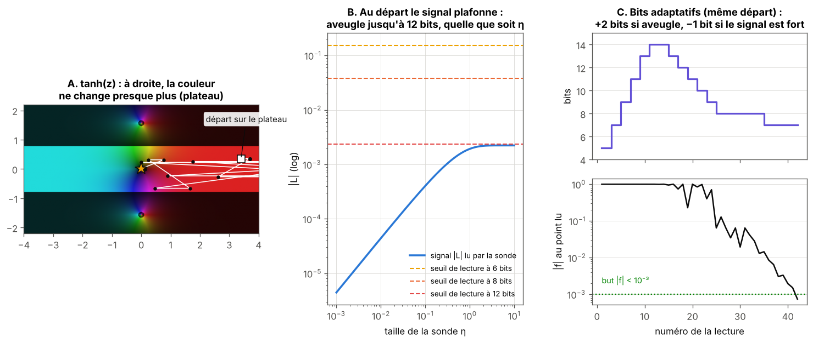
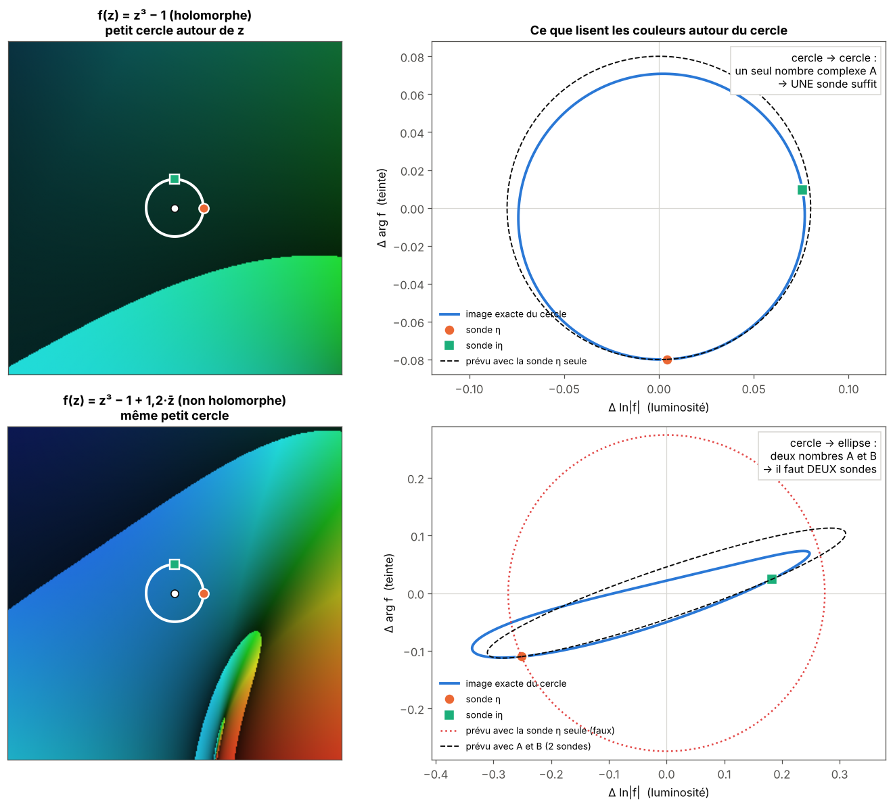
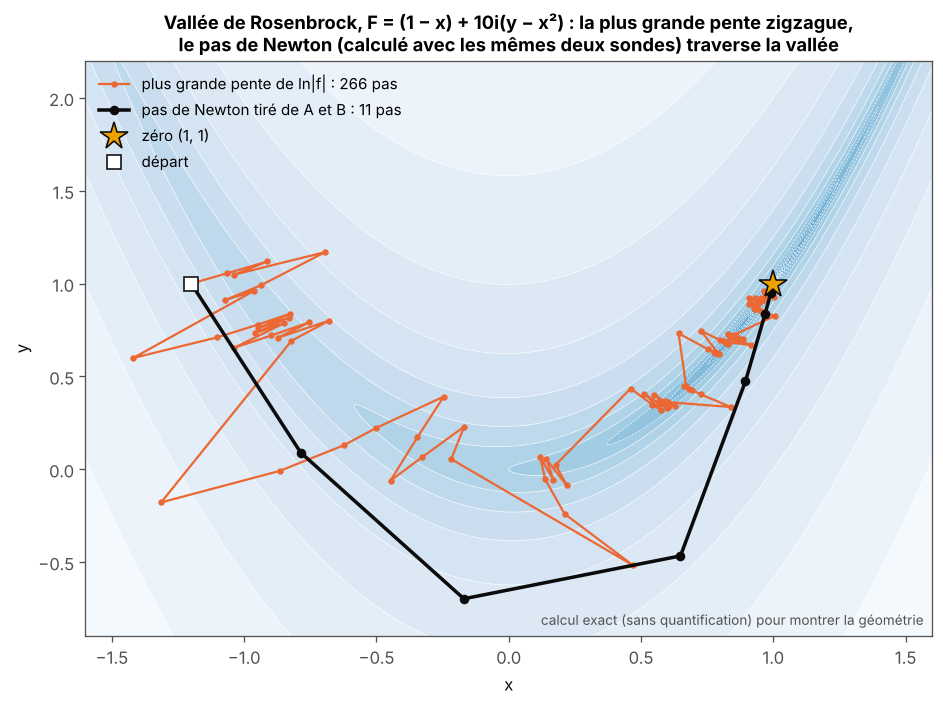
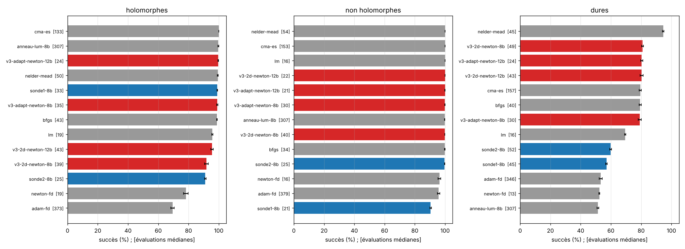
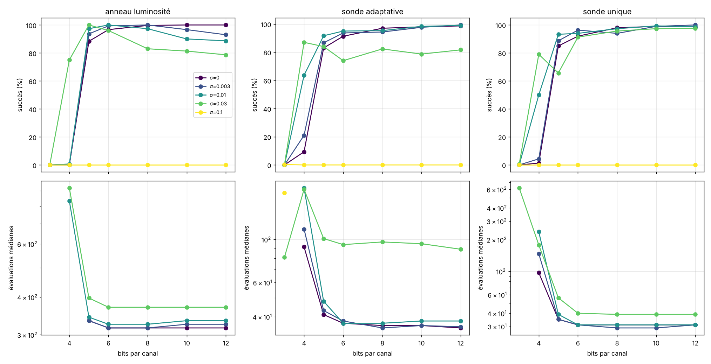

# Partie 2 : optimisation, limites de la sonde et améliorations

> **En bref.** Chaque limite mesurée de la sonde a donné une amélioration : la règle « aveugle » pour les plateaux, la sonde à **deux directions** pour les fonctions non holomorphes, le **pas de Newton** tiré des couleurs pour les vallées, une sonde **adaptative** et des **bits adaptatifs** pour économiser des lectures. Résultat final (5 graines) : 99-100 % sur les fonctions holomorphes et non holomorphes en 21-35 évaluations, 80 % sur les fonctions dures (Nelder-Mead : 95 %). Les méthodes classiques lisent `f` en double précision dans cette partie.

Détails des bancs intermédiaires : [comparaison aux méthodes classiques](notes/comparaison_methodes_classiques.md), [fonctions non holomorphes](notes/fonctions_non_holomorphes.md), [fonctions dures](notes/fonctions_dures.md).

Chaque amélioration est née d'une limite mesurée. Tous les chiffres viennent des bancs de ce dossier ; les chiffres finaux sont ceux de `bench_v3.py` (5 graines de départs).

## 2.1 Protocole

- **Coût** : nombre d'évaluations de `f` (une évaluation complexe vaut 1). Une lecture de capteur vaut 1 ; un gradient par différences finies en 2D vaut 3 ; une dérivée exacte vaut 1 de plus. Le point final est vérifié (+1).
- **Succès** : un point avec `|f| < 1e-3` avant 1 000 évaluations. L'arrêt utilise l'oracle `|f|` pour toutes les méthodes (mesure seulement ; voir 2.8 pour un arrêt sans oracle).
- **Fonctions** : 9 holomorphes (tanh, z³−1, quad, poly5, racine double, sin z−z, eᶻ−z−1, (z²+1)/(z²−1), sigmoïde−0,5), 14 non holomorphes (par morceaux, `z³−1+ε z̄`, `conj(z³−1)`, génériques), 12 « dures » (Rosenbrock, Himmelblau, jacobien singulier, mal conditionné, plateau, Rastrigin, valeurs réelles).
- **Réglage** : recherche aléatoire de 8 configurations (4 pour scipy et CMA-ES, 1 pour Newton-FD, LM et l'anneau) sur 6 départs par fonction, graine différente de celle du test. **Test** : 5 graines de départs × 60 départs par fonction.
- **Capteur** : les méthodes couleur lisent un capteur 8 ou 12 bits ; les méthodes classiques lisent `f` en double précision, ce qui les avantage.

## 2.2 Règle « aveugle » : le plateau de tanh

Sur tanh (|Re z| ≳ 3) la couleur est presque constante : la sonde ne voit rien dans la direction +1 et agrandir `η` n'aide pas. Règle : si `|L|` est sous le seuil de quantification, essayer les directions +i, −1, −i au même `η` (une lecture chacune) avant d'agrandir `η`, et garder la direction qui marche.

| tanh, 961 départs | 8 bits | 12 bits |
|---|---|---|
| sonde fixe | 68 % | 85 % |
| + règle aveugle | **89 %** | **94 %** |

*A : départ sur le plateau de tanh. B : le signal lu par la sonde plafonne vers 2·10⁻³ quelle que soit la taille de la sonde ; il reste sous le seuil de lecture jusqu'à 12 bits. C : avec les bits adaptatifs (section 2.9), la sonde monte à 14 bits, sort du plateau, puis redescend à 7-8 bits.*

Sans régression sur les cinq autres fonctions testées. Pistes testées **sans succès** : direction aléatoire à chaque pas (52 % à 8 bits) ; orientation de la sonde sur la dernière direction de descente (40 %). Explication de la règle (non vérifiée) : au premier ordre `|L| = η|f'/f|` ne dépend pas de la direction, mais sur le plateau la non-linéarité est forte et un autre angle franchit parfois un seuil de quantification que le premier ratait.

## 2.3 Limite 1 : hors holomorphie, et sonde à deux directions

La sonde unique suppose `f'/f` identique dans toutes les directions. Test sur 14 fonctions non holomorphes (exp. 3) : elle réussit sur les fonctions holomorphes par morceaux (coupures de `√`, `ln`, racine cubique : 98-100 %), même sur `z³−1+ε z̄` jusqu'à ε = 100 (explication inconnue), mais **échoue sur `conj(z³−1)` (0 %)** et mal sur les applications `R² → R²` génériques (53-70 % sur les cubiques, 89 % à 12 bits sur cercle ∩ droite).

Remède : sonde à deux directions (`η` et `iη`, 3 lectures). `ln f(z+h) − ln f(z) ≈ A h + B h̄` ; les deux lectures donnent `A = (a − ib)/2` et `B = (a + ib)/2`. Pour `B = 0` on retrouve la sonde unique. Décompte : 4 inconnues réelles, 2 par sonde, donc 2 sondes.

*Ce que lisent les couleurs (variation de luminosité, variation de teinte) quand on fait le tour d'un petit cercle. Holomorphe : le cercle reste un cercle, un seul nombre complexe `A` le décrit, une sonde suffit. Non holomorphe : il devient une ellipse ; la sonde seule (pointillé rouge) se trompe, deux sondes donnent `A` et `B` et retrouvent l'ellipse (tirets).*

Résultat final (5 graines, 14 fonctions non holomorphes) : sonde unique 90,4 %, sonde à 2 directions **99,7 %** (25 évaluations médianes).

## 2.4 Limite 2 : vallées et mauvais conditionnement, et pas de Newton

Sur les fonctions dures (exp. 4) les deux sondes, comme l'anneau et Adam, échouent sur Rosenbrock (résidus) et le cas mal conditionné 1:100 (0-9 %) : le pas « plus grande pente » zigzague. Avec `A` et `B`, on peut calculer à coût nul le **pas de Newton** : on résout `A h + B h̄ = −1`, soit `h = (−Ā + B)/(|A|² − |B|²)` (valable aussi quand le déterminant est négatif, applications qui renversent l'orientation). Les modules `|f|` s'éliminent : seules les couleurs servent. Pour `B = 0`, `h = −f/f'`.

*Dans une vallée étroite, suivre la plus grande pente de `ln|f|` zigzague (266 pas ici) ; le pas de Newton, calculé avec les mêmes deux sondes, traverse la vallée (11 pas). Calcul exact, sans quantification, pour isoler la géométrie.*

Effet (familles « dures », 5 graines) : sonde unique 57,1 %, sonde à 2 directions 59,8 %, **sonde à 2 directions avec pas de Newton : 80,3 % à 81,0 %**. Rosenbrock (résidus) : 0 % → 79-99 %. Mal conditionné : 6-9 % → 100 %. Cercle ∩ sinusoïde : 68-84 % → 100 %.

## 2.5 Sonde adaptative

Pour limiter le coût : une direction (2 lectures) tant que ça marche, deux directions (3 lectures) quand la sonde unique devient peu fiable. Critère : après chaque pas, la lecture au nouveau point est comparée à la prédiction `ln(1 + A d + B d̄)` ; si l'écart dépasse `τ`, passage à deux directions ; retour à une direction après 3 pas cohérents. `τ` est réglé (0,5 à 0,8).

Limite du critère : il confond non-holomorphie et non-linéarité (un pas de Newton de 0,7 fois la distance est déjà en dehors du domaine linéaire de `ln f`), donc il déclenche des fausses alarmes. L'économie par rapport à « toujours 2 directions » est modeste : 8 bits, médiane de 35 contre 39 évaluations (holomorphes), 30 contre 40 (non holomorphes), 30 contre 49 (dures), à succès comparable sur les non holomorphes et les dures (79,1 % contre 81,0 % sur les dures) et meilleur sur les holomorphes (99,0 % contre 91,8 %, car la règle « aveugle » de la sonde à 1 direction gère mieux le plateau de tanh).

## 2.6 Résultats finaux (5 graines)

Entre crochets : évaluations médianes. Rouge : variantes « v3 » (pas de Newton). Détail : `parties/2_zeros_en_2d/bench_v3_tables.md`.

**Fonctions holomorphes (9)** : CMA-ES 100,0 % [133] ; anneau luminosité 99,7 % [307] ; **sonde adaptative + Newton 12 bits 99,6 % [24]** ; Nelder-Mead 99,3 % [50] ; sonde unique 8 bits 99,0 % [33] ; sonde adaptative + Newton 8 bits 99,0 % [35] ; BFGS 98,7 % [43] ; LM 95,7 % [19] ; Newton-FD 78,3 % [19] ; Adam-FD 69,4 % [373].

**Fonctions non holomorphes (14)** : Nelder-Mead, CMA-ES, LM et la sonde adaptative + Newton à 12 bits font 100 % ; coûts [54], [153], [16] et [21]. Sonde adaptative + Newton 8 bits : 99,8 % [30]. Sonde unique : 90,4 % [21].

**Fonctions dures (12)** : Nelder-Mead 94,6 % [45] ; sonde à 2 directions + Newton 8 bits 81,0 % [49] ; **sonde adaptative + Newton 12 bits 80,4 % [24]** ; CMA-ES 79,4 % [157] ; BFGS 79,3 % [40] ; LM 69,5 % [16] ; Newton-FD 52,4 % [13] ; anneau luminosité 51,4 % [307].

Écarts-types entre graines : 0,0 à 1,5 point (les différences de plus de 3 points sont donc réelles pour ces départs ; elles ne couvrent pas la variabilité du réglage).

**Ce qu'il faut en retenir :**
- La sonde adaptative + Newton dépasse 99 % sur les holomorphes et les non holomorphes, comme Nelder-Mead, CMA-ES et l'anneau luminosité, avec un coût médian plus faible que ces trois (24-35 et 21-30, contre 50-54, 133-153 et 307), malgré un capteur quantifié. À 8 bits : 99,0 % [35] et 99,8 % [30]. LM est moins chère (16-19) mais fait 95,7 % sur les holomorphes.
- Sur les fonctions dures elle est au niveau de BFGS et CMA-ES (79-81 %) pour un coût inférieur (24-30, contre 40 et 157), mais **loin de Nelder-Mead (94,6 %)**.
- LM et Newton-FD sont moins chers (16-19) quand ils marchent ; Newton-FD échoue sur les plateaux et les coupures.

## 2.7 Sensibilité : bits, bruit, échelle

`parties/2_zeros_en_2d/bench_sens.py`, 3 fonctions holomorphes (z³−1, tanh, poly5), 100 départs chacune, réglages par défaut.

- **Bits** : sans bruit, 5 bits suffisent à environ 85 % (sonde 83-85 %, anneau 88 %), 6 bits 91-97 %, 8 bits 97-100 %. 3 et 4 bits échouent (0-9 %).
- **Bruit** (gaussien par canal RGB, un niveau 8 bits = 0,004) : jusqu'à σ = 0,01 la sonde unique reste à 89-100 % dès 5 bits ; à σ = 0,03 elle garde 91-98 % à 6 bits et plus, alors que la sonde adaptative tombe à 74-82 % (6 bits et plus) et l'anneau à 79-83 % (8 à 12 bits). **À σ = 0,1 toutes les méthodes échouent (0 %).** Le déclencheur du changement de mode de la sonde adaptative est sensible au bruit.
- **Échelle** (`f → s f`, `s` de 10⁻¹² à 10¹²) : la sonde unique garde 98 % à toutes les échelles. BFGS sur `|f|²` tombe à 0 % pour `s ≤ 10⁻³` et 40 % à `s = 10¹²` ; **BFGS sur `ln|f|` garde 99 %** : l'invariance vient du logarithme ; la couleur permet de la conserver avec un capteur de 8 bits.

## 2.8 Arrêt sans oracle

Critère : arrêter quand la distance estimée au zéro (longueur du pas de Newton, `1/|f'/f|` pour `B = 0`) passe sous un seuil `ε_z` choisi par l'utilisateur, sans jamais évaluer `|f|`. Sur z³−1, tanh et poly5 :

| seuil `ε_z` | 8 bits | 12 bits |
|---|---|---|
| 10⁻¹, 10⁻² | arrêt trop tôt (`|f| > 1e-3`) | idem |
| 10⁻³ | arrêt déclenché 98-99 %, dont 62 % avec `|f| < 1e-3` | idem |
| **10⁻⁴** | arrêt déclenché 98-99 %, **98 % de succès**, 33 évaluations médianes | idem |

Un seuil `ε_z = 10⁻⁴` en distance donne un arrêt fiable pour une tolérance `|f| < 10⁻³` sur ces fonctions (où `|f| ≈ |f'| · distance` avec `|f'|` de l'ordre de 1 à 3) : le seuil dépend de l'échelle de `f'`, que l'on ne connaît pas à l'avance. Le coût médian est comparable à celui avec oracle (31 pour la sonde unique à 8 bits). Environ 2 % des départs ne déclenchent jamais l'arrêt (plateau ou stagnation).

## 2.9 Bits adaptatifs

Idée : ne payer la précision que quand elle sert. La sonde part de 5 bits, en ajoute 2 quand elle est aveugle (variation sous ~3 niveaux de quantification, avant de tourner la sonde ou d'agrandir `η`), en retire 1 quand le signal dépasse 16 seuils. Code : `src/color_probe3.py` (`bits_adapt`), banc : `bench_bits.py`. Mêmes réglages et départs que la sonde adaptative + Newton 12 bits de 2.6, 3 graines × 60 départs par fonction. Coût en bits = somme des bits des lectures.

| famille | 8 bits fixes | 12 bits fixes | adaptatif 5-14 |
|---|---|---|---|
| holomorphes | 98,8 % (25 év. ; 192 bits) | 99,4 % (24 ; 276) | 99,6 % (28 ; 192) |
| non holomorphes | 99,9 % (23 ; 176) | 100 % (21 ; 240) | 100 % (27 ; 172) |
| dures | 75,1 % (24 ; 184) | 80,4 % (24 ; 276) | 77,9 % (30 ; 214) |

Lecture : sur les familles faciles, le succès du 12 bits pour le coût en bits du 8 bits, au prix de quelques lectures de plus. Sur les fonctions dures, entre les deux. Gain modeste. Le schéma de 2.2 (panneau C) montre le mécanisme sur un départ.

## 2.10 Limites et ce qui reste en échec

- **Fonctions réelles à zéro dégénéré** (Rosenbrock réelle : 4-19 %) et **multimodales** (Rastrigin : 15-63 %) : aucune amélioration. Pas de principe du minimum du module hors holomorphie, donc des minima locaux parasites.
- **Réglage** : une seule graine pour le réglage, 6 départs par fonction ; les écarts-types de 2.6 ne couvrent pas la variabilité du réglage. Les concurrents classiques (Adam, GD) ont un réglage modeste (un seul taux d'apprentissage).
- **Capteur contre double précision** : les sondes lisent un capteur quantifié ; les concurrents lisent `f` exactement. Le banc est défavorable aux sondes sur ce point.
- **Coût en temps de calcul** non mesuré.
- **Dimension 1 complexe** ici ; voir la partie 3 pour `Cⁿ`.
