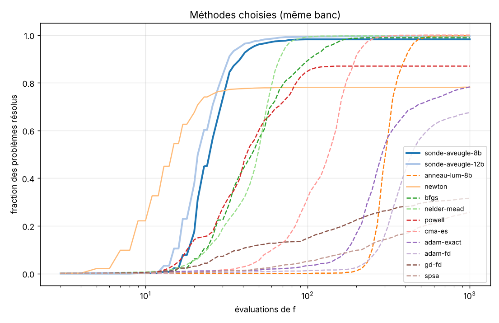

# Exp. 2 : comparaison 2D à coût d'évaluations égal

`bench2d.py` compare la descente par couleurs (sonde unique avec/sans règle « aveugle », anneaux luminosité et teinte, capteur 8 et 12 bits) à 14 méthodes classiques, sur 9 fonctions holomorphes `f : C → C`, 200 départs uniformes par fonction (1 800 problèmes). `bench2d_figs.py` produit les tables et figures à partir de `bench2d_results.json`.

## Protocole

- **Coût** : nombre d'évaluations de `f`. Dérivée exacte facturée 1 évaluation de plus par pas ; gradient par différences finies = 3 évaluations (point + 2 directions) ; une lecture de capteur couleur = 1 évaluation (+1 pour vérifier le point final).
- **Succès** : un point avec `|f| < 1e-3` avant 1 000 évaluations. Même seuil et même budget pour tous. L'arrêt utilise l'oracle `|f|` pour toutes les méthodes (mesure seulement).
- **Réglage** : recherche aléatoire de 12 configurations (4 pour scipy et CMA-ES, 1 pour Newton et les anneaux) sur 8 départs par fonction, **graine différente de celle du test**. Le réglage maximise le succès, puis minimise le coût médian, tous problèmes confondus. Les deux pertes `ln|f|` et `|f|²` sont dans l'espace de recherche des méthodes classiques.
- **Fonctions** : tanh, z³−1, quad, poly5, racine double, sin z − z, eᶻ−z−1, (z²+1)/(z²−1) (pôles), sigmoïde(z) − 0,5.
- **Méthodes classiques** : GD, momentum, RMSprop, Adam (chacun avec gradient exact et par différences finies), Newton, SPSA, BFGS, Nelder-Mead, Powell, CMA-ES.

Les méthodes classiques lisent `f` en double précision, les méthodes couleur un capteur quantifié : le banc est donc **défavorable aux méthodes couleur sur ce point**.

## Résultats (tous problèmes confondus)



| méthode | succès (IC 95 %) | évaluations médianes | 90e centile |
|---|---|---|---|
| cma-es | 100 % (100-100) | 135 | 196 |
| anneau-lum-12b | 100 % (100-100) | 307 | 406 |
| anneau-teinte-12b | 100 % (100-100) | 109 | 172 |
| anneau-lum-8b | 100 % (99-100) | 307 | 397 |
| nelder-mead | 100 % (99-100) | 50 | 67 |
| sonde-aveugle-12b | 100 % (99-100) | 21 | 33 |
| bfgs | 99 % (98-99) | 46 | 100 |
| sonde-fixe-12b | 99 % (98-99) | 19 | 35 |
| sonde-aveugle-8b | 98 % (98-99) | 25 | 37 |
| anneau-teinte-8b | 97 % (96-98) | 109 | 163 |
| sonde-fixe-8b | 94 % (93-95) | 33 | 49 |
| powell | 87 % (85-88) | 40 | 83 |
| adam-exact | 78 % (76-80) | 259 | 475 |
| newton | 78 % (76-80) | 13 | 21 |
| rmsprop-exact | 77 % (75-79) | 259 | 687 |
| rmsprop-fd | 72 % (70-74) | 265 | 627 |
| adam-fd | 68 % (65-70) | 361 | 565 |
| momentum-exact | 50 % (47-52) | 247 | 686 |
| momentum-fd | 47 % (45-49) | 382 | 624 |
| gd-exact | 37 % (35-40) | 65 | 409 |
| gd-fd | 32 % (29-34) | 109 | 438 |
| spsa | 26 % (24-28) | 257 | 719 |

Succès par fonction (%) : [`bench2d_table_par_fonction.md`](../bench2d_table_par_fonction.md), carte : `figures/bench2d_succes.png`. Profils de toutes les méthodes : `figures/bench2d_profils.png`.

## Lecture

- **Sonde aveugle 12 bits** : 100 % de succès pour 21 évaluations médianes, **la moitié du coût de Nelder-Mead (50) et de BFGS (46)**, à succès comparable. À 8 bits : 98 % pour 25. La règle « aveugle » fait passer la sonde de 94 % à 98 % (8 bits) et de 99 % à 100 % (12 bits) ; le gain est surtout sur tanh (70 → 94 % à 8 bits) et sigmoïde (84 → 94 %).
- **Newton** est le moins cher (13) mais échoue sur tanh, la fonction rationnelle et la sigmoïde (25 %, 40 %, 39 %), où `f'` s'annule ou `f/f'` expédie loin : 78 % au total.
- **Nelder-Mead, BFGS et CMA-ES** réussissent presque tout mais coûtent 2 à 6 fois plus que la sonde.
- **Les méthodes du premier ordre** (GD, momentum, RMSprop, Adam) sont nettement moins bonnes ici (26 à 78 % de succès pour un coût médian de 65 à 380 ; SPSA : 26 %). Elles minimisent une perte dont l'échelle varie fortement d'une fonction à l'autre, avec un seul taux d'apprentissage réglé sur l'ensemble des fonctions : c'est une limite du protocole (voir ci-dessous), pas un verdict sur Adam en général.
- **Anneau luminosité** : très robuste (98-100 %), mais 300 évaluations médianes. Anneau teinte : 97-100 % pour ≈110.

## Limites (à ne pas oublier avant de conclure)

- Un seul tirage de départs (graine 1), 200 par fonction ; intervalles de Wilson fournis mais pas de répétition sur plusieurs graines.
- Réglage modeste (12 configurations en recherche aléatoire, un taux d'apprentissage commun à toutes les fonctions). Un réglage par fonction ou un planning de taux d'apprentissage améliorerait Adam/GD ; ce n'est pas testé.
- Les paramètres de la sonde (`c`, `step_frac`, `cap`) sont aussi réglés sur le même protocole ; les anneaux ne sont pas réglés (valeurs par défaut).
- Problèmes holomorphes de dimension 1 seulement ; la sonde y exploite une structure (Cauchy-Riemann) que les méthodes classiques n'utilisent pas. La comparaison mesure donc l'intérêt de cette structure plus que celui de la couleur.
- Le critère de succès accepte n'importe quel point évalué sous le seuil pour les méthodes classiques, et le point final pour les méthodes couleur.
- Les méthodes sont comparées sur le coût en évaluations, pas sur le temps de calcul.

## Reproduire

```
pip install numpy scipy matplotlib cma
python bench2d.py          # ≈ 3 min sur 2 cœurs, écrit bench2d_results.json
python bench2d_figs.py     # tables et figures
```
