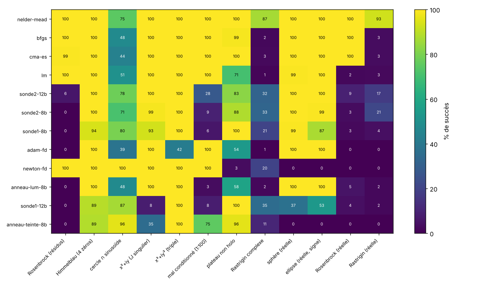

# Exp. 4 : fonctions plus dures, `F = u(x,y) + i v(x,y)` avec `u`, `v` réelles

Cas général `R² → R²` (toute application lisse s'écrit ainsi) et cas à valeurs réelles. Même protocole que l'exp. 3 (coût en évaluations, budget 1 000, `|F| < 1e-3`, réglage sur d'autres départs, 150 départs par fonction, une graine). Méthodes : sondes unique (`sonde1`) et à 2 directions (`sonde2`), anneaux, Adam-FD, BFGS, Nelder-Mead, CMA-ES, Newton-FD, Levenberg-Marquardt.

## Fonctions

| famille | fonctions |
|---|---|
| vallée courbe | Rosenbrock en résidus `(1−x) + 10i(y−x²)` |
| plusieurs zéros | Himmelblau `(x²+y−11) + i(x+y²−7)` (4 zéros) |
| minima parasites possibles | cercle ∩ sinusoïde `(x²+y²−1) + i(y − 0,7 sin 3x)` |
| zéros dégénérés (jacobien singulier) | `x² + iy`, `x³ + iy³` |
| mal conditionné | `(x−1) + 0,01i(y−2)` |
| plateau non holomorphe | `tanh(x+0,3y) + i tanh(y−0,3x)` |
| multimodal | Rastrigin complexe `(x²+10−10cos 2πx) + i(y²+10−10cos 2πy)` |
| à valeurs réelles | sphère, ellipse `x²+3y²−1` (change de signe), Rosenbrock réelle, Rastrigin réelle |

## Résultats : succès (%)



Tableaux complets : [`bench_hard_succes.md`](../bench_hard_succes.md), coûts médians : [`bench_hard_cout.md`](../bench_hard_cout.md).

| méthode | succès moyen (12 fonctions) |
|---|---|
| Nelder-Mead | 96 % |
| BFGS, CMA-ES | 79 % |
| LM | 69 % |
| sonde à 2 directions 12 bits / 8 bits | 63 % / 60 % |
| sonde unique 8 bits | 57 % |
| Adam-FD, Newton-FD, anneau luminosité | 52-53 % |
| sonde unique 12 bits | 44 % |
| anneau teinte | 42 % |

## Lecture

- **Les sondes ne marchent pas partout.** La sonde à 2 directions est à 99-100 % sur Himmelblau, sur les zéros dégénérés `x² + iy` et `x³ + iy³`, sur la sphère et l'ellipse réelles (la sonde unique : 89-100 % sur Himmelblau et `x³ + iy³`, mais très variable ailleurs, voir plus bas). Les deux sondes **échouent sur les vallées courbes et mal conditionnées** : Rosenbrock en résidus (0-6 %), mal conditionné 1:100 (6-28 %), Rosenbrock réelle (3-9 %). Elles échouent aussi sur les fonctions multimodales (Rastrigin complexe 21-35 %, Rastrigin réelle 2-21 %).
- **Sur ce banc, les méthodes qui estiment un jacobien et résolvent un système (Newton-FD, LM, BFGS) ou explorent (Nelder-Mead) gagnent largement.** Les sondes, les anneaux et Adam, qui suivent surtout une direction de plus grande pente avec un pas normalisé, partagent les mêmes échecs sur Rosenbrock et le mauvais conditionnement. Hypothèse non vérifiée : c'est le pas de type plus grande pente qui zigzague dans une vallée étroite. Une direction de Newton calculée à partir des lectures de la sonde à 2 directions pourrait corriger cela (voir ci-dessous).
- **La sonde unique est fragile hors holomorphie** (`x²+iy` : 93 % à 8 bits mais 8 % à 12 bits ; sphère 99 % contre 37 %). Les écarts 8 bits / 12 bits n'ont pas de raison physique : le réglage (6 départs par fonction, 8 configurations) est bruité, et la sonde unique y est sensible. À ne pas interpréter.
- **Les fonctions à valeurs réelles** (la teinte est alors constante, ou vaut 0 ou π) sont bien traitées par la sonde à 2 directions pour les cas unimodaux (sphère 100 %, ellipse 99-100 %), mais l'anneau teinte (0 %) et Newton-FD (0 %) y échouent.
- **Zéros dégénérés (jacobien singulier)** : pas de problème pour la sonde à 2 directions (99-100 %), même si le coût médian est plus élevé (76-82 évaluations).
- **Les minima parasites** (cercle ∩ sinusoïde, Rastrigin) ne sont évités par aucune méthode locale : le principe du minimum du module, qui garantit pour `f` holomorphe l'absence de minima locaux de `|f|` non nuls, n'existe plus ici. Seul Nelder-Mead (grand simplexe initial) s'en sort souvent.

## Suite

Avec `A` et `B` estimés par la sonde à 2 directions, le pas de Newton `h` résout `A h + B h̄ = −1`, soit `h = (−Ā + B)/(|A|² − |B|²)` ; pour `B = 0` on retrouve le pas de Newton complexe `−f/f'`. Remplacer la descente normalisée par ce pas corrige une bonne partie des échecs de conditionnement : voir la section 2.4 du [README de la partie 2](../README.md) (Rosenbrock en résidus : 0 % → 79-99 %, mal conditionné : 100 %).

## Limites

- Une graine, 150 départs par fonction, réglage bruité (6 départs par fonction pour 8 configurations, un seul jeu pour toutes les fonctions). Ne pas comparer finement 8 et 12 bits.
- Budget de 1 000 évaluations : les échecs sur Rosenbrock sont en partie des échecs de budget.
- Tolérance `|F| < 1e-3` sur des fonctions réelles quadratiques (sphère, ellipse) correspond à une distance au zéro de l'ordre de 0,03, plus lâche que sur les fonctions linéaires près du zéro.
- Les méthodes classiques lisent `F` en double précision, les méthodes couleur un capteur quantifié.

## Reproduire

```
python bench_hard.py        # ≈ 7 min sur 2 cœurs
python bench_hard_figs.py
```
