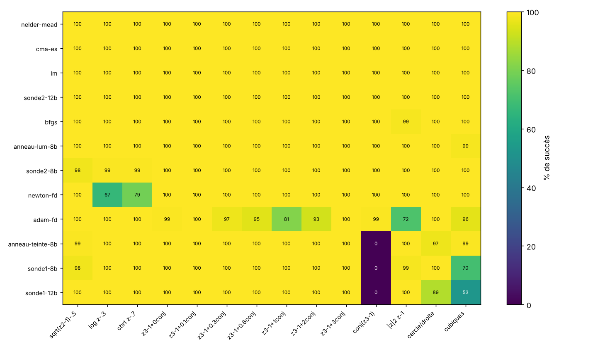

# Exp. 3 : fonctions non holomorphes

Question : la sonde unique, qui suppose `f'/f` identique dans toutes les directions (donc `f` holomorphe), marche-t-elle quand `f` n'est holomorphe que localement, ou pas du tout ? Et que faut-il changer sinon ?

## Sonde à deux directions (`src/color_probe2.py`)

Pour `f` lisse quelconque (`R² → C`), `ln f(z+h) - ln f(z) ≈ A h + B h̄` (dérivées de Wirtinger `A = ∂ ln f/∂z`, `B = ∂ ln f/∂z̄`). Deux sondes `h = η` et `h = iη` (3 lectures par pas) donnent `a = A + B` et `b = i(A - B)`, d'où `A = (a - ib)/2`, `B = (a + ib)/2`. Le gradient de `ln|f|` est `conj(A) + B` ; si `B = 0` (holomorphe) on retrouve `conj(f'/f)`, la sonde unique. Décompte : 4 inconnues réelles (`A`, `B`), 2 réelles par sonde, donc 2 sondes.

## Fonctions (14)

- **par morceaux** : holomorphes sauf sur une coupure (branche principale) : `√(z²−1) − 0,5`, `ln z − 0,3`, `z^(1/3) − 0,7` ;
- **perturbées** : `z³ − 1 + ε·z̄`, ε ∈ {0 ; 0,1 ; 0,3 ; 0,6 ; 1 ; 2 ; 3} ;
- **anti-holomorphe** : `conj(z³ − 1)` ;
- **génériques** `R² → R²` : `|z|² z − 1`, cercle ∩ droite `(x²+y²−1) + i(x−2y+0,3)`, cubiques `(x³−3x+y) + i(y³−3y−x)`.

Protocole identique à l'exp. 2 (coût en évaluations de `f`, budget 1 000, `|f| < 1e-3`, réglage sur d'autres départs, 150 départs par fonction, une seule graine). Méthodes classiques : Adam-FD, BFGS, Nelder-Mead, CMA-ES, **Newton à jacobien par différences finies** (3 évaluations/pas), **Levenberg-Marquardt** (`scipy`, jacobien FD).

## Résultats



Succès (%) par méthode et par fonction : [`bench_nonholo_succes.md`](../bench_nonholo_succes.md). Coûts médians : [`bench_nonholo_cout.md`](../bench_nonholo_cout.md).

| méthode | succès moyen (14 fonctions) | remarque |
|---|---|---|
| Nelder-Mead, CMA-ES, LM, sonde2 12 bits, BFGS, anneau luminosité | 100 % | |
| sonde à 2 directions, 8 bits | 100 % (98-100 % selon la fonction) | 22 à 88 évaluations médianes |
| Newton-FD | 96 % | échoue sur `ln z` (67 %) et `z^(1/3)` (79 %) : les coupures |
| Adam-FD | 95 % | |
| anneau teinte, 8 bits | 93 % | **0 % sur `conj(z³−1)`** (suppose l'holomorphie) |
| sonde unique, 8 bits | 90 % | **0 % sur `conj(z³−1)`**, 70 % sur les cubiques |
| sonde unique, 12 bits | 89 % | 0 % sur `conj(z³−1)`, 53 % sur les cubiques |

Ce que disent ces chiffres :

1. **Holomorphe par morceaux suffit** : la sonde unique réussit à 98-100 % sur `√(z²−1)`, `ln z` et `z^(1/3)`, malgré les coupures, avec ≈ 20 évaluations médianes. Newton-FD y échoue davantage.
2. **L'holomorphie locale est suffisante, pas nécessaire.** Sur `z³ − 1 + ε z̄` la sonde unique réussit à 100 % de ε = 0 à ε = 100 (balayage prolongé : `bench_nonholo_eps_large.py`), alors que ce n'est holomorphe nulle part pour ε ≠ 0. Je n'ai pas d'explication vérifiée.
3. **Elle échoue franchement sur le cas anti-holomorphe** (`conj(z³−1)` : 0 %), et mal sur les cubiques `R² → R²` (53-70 %), et le cas cercle/droite à 12 bits (89 %).
4. **La sonde à 2 directions règle ces cas** (100 % sur `conj(z³−1)` et les cubiques) pour 3 lectures par pas au lieu de 2.
5. **Sur ces fonctions lisses, LM et Newton-FD sont moins chers** (13 à 25 évaluations médianes, contre 22 à 88 pour la sonde à 2 directions) : ces problèmes sont faciles pour un jacobien par différences finies en double précision. L'intérêt de la sonde ici est de n'utiliser qu'un capteur quantifié, pas de coûter moins cher.
6. Le coût de la sonde (unique et à 2 directions) monte à ε = 1 (≈ 55-65 évaluations contre ≈ 20 ailleurs) ; je ne l'ai pas étudié.

## Limites

- Une graine, 150 départs par fonction, réglage modeste (8 configurations pour les méthodes couleur, 4 pour scipy et CMA-ES). Les fonctions sont lisses et à zéros non dégénérés ; aucune n'a de zéro à jacobien singulier ni de plateau.
- Les méthodes classiques lisent `f` en double précision, les méthodes couleur un capteur 8 ou 12 bits.
- Le critère de succès repose sur l'oracle `|f|`, comme dans l'exp. 2.
- Pour une `f` à valeurs réelles (une seule équation), la teinte ne porte aucune information : cas non testé.

## Reproduire

```
python bench_nonholo.py          # ≈ 3 min sur 2 cœurs
python bench_nonholo_figs.py
python bench_nonholo_eps_large.py
```
