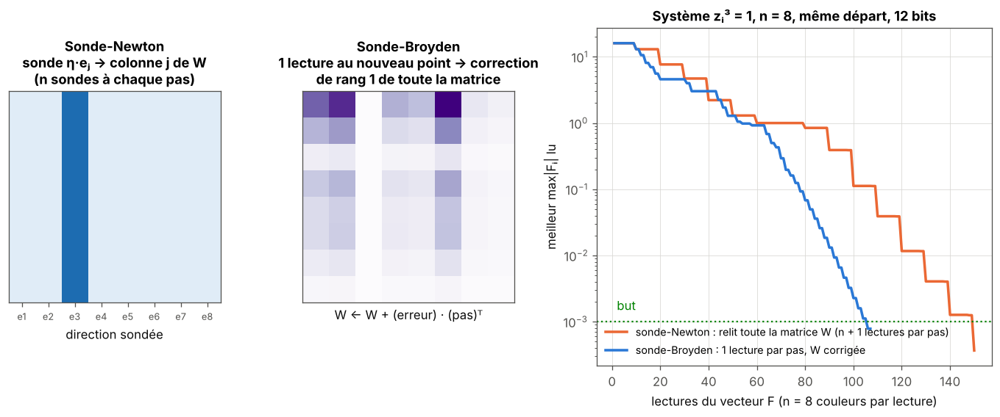
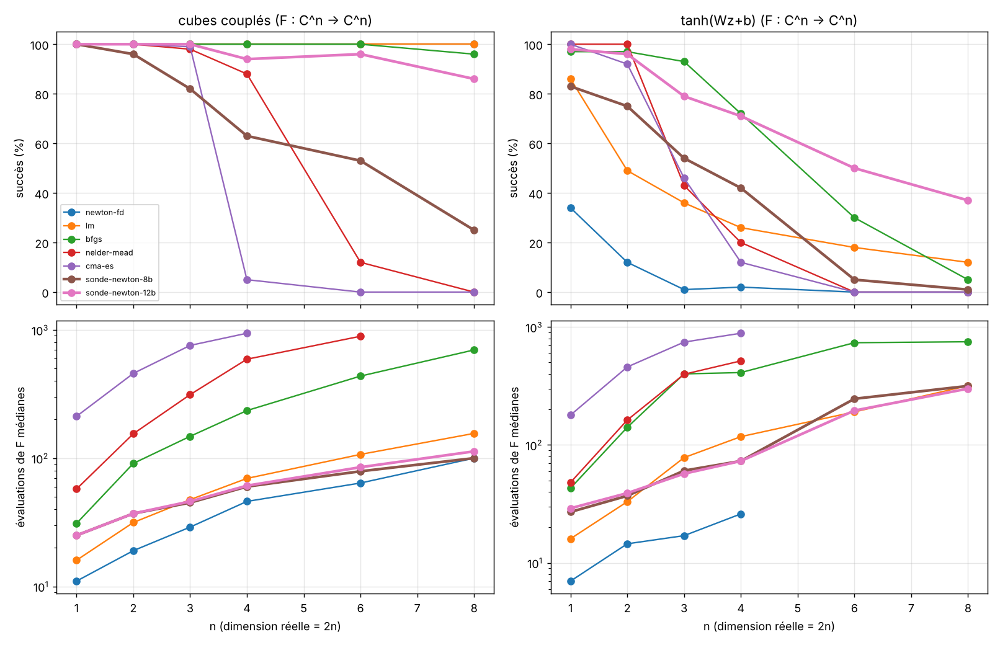

# Partie 3 : dimension n

> **En bref.** La sonde se généralise aux systèmes `F : Cⁿ → Cⁿ` : `n` sondes donnent la matrice `W = ∂ ln Fᵢ/∂zⱼ`, et le pas de Newton `h = −W⁻¹·1` ne demande que les couleurs. Relire `W` à chaque pas coûte `n + 1` lectures ; la **réutiliser** (mise à jour de type Broyden, 1 lecture par pas) fait croître le coût lentement avec `n`. Elle bat Newton-FD, LM et BFGS dès `n ≈ 8` sur des systèmes simples, **pas Broyden classique** (sauf un cas). À 8 bits la fiabilité chute quand `n` grandit ; les bits adaptatifs la corrigent. Face aux méthodes sans dérivée générales (Nelder-Mead, Powell, CMA-ES), elle gagne largement dès `n = 4` (3.4). Attention : dans cette partie, les concurrents lisent `F` en double précision ; la partie 6 refait la comparaison avec les mêmes mesures pour tous.

*À gauche : la sonde-Newton relit chaque colonne de `W` à chaque pas. Au centre : la sonde-Broyden corrige toute la matrice avec une seule lecture (correction de rang 1). À droite : sur le même système `zᵢ³ = 1` en dimension 8, la seconde atteint le but en ~105 lectures, la première en ~150.*

## 3.1 Premier essai (n de 1 à 8)

Cette section était un **premier regard**, pas une étude : réglages par défaut pour toutes les méthodes, une seule graine de départs (100 par cas), budget de 1 000 évaluations de `F`.

### 3.1.1 Généralisation de la sonde à `F : Cⁿ → Cⁿ` holomorphe

Un système de `n` équations holomorphes à `n` inconnues complexes. Le capteur lit, pour une évaluation de `F`, **`n` couleurs** : `(ln|Fᵢ| mod ln 10, arg Fᵢ)` pour chaque composante.

Modèle local : `Fᵢ(z+h) = Fᵢ(z) · (1 + Σⱼ Wᵢⱼ hⱼ)`, avec `Wᵢⱼ = ∂ ln Fᵢ / ∂ zⱼ`. Chaque sonde `η eⱼ` donne la colonne `j` de `W` par différence de couleurs : `n` sondes, donc **`n + 1` évaluations de `F` par pas** (autant que des différences finies).

**Pas de Newton à partir des couleurs seules.** L'équation de Newton `J h = −F` devient, en divisant la ligne `i` par `Fᵢ` : `W h = −1` (le vecteur de uns). Les modules `|Fᵢ|`, que le capteur ne donne pas, **disparaissent** : `h = −W⁻¹ 1`. Pour `n = 1` on retrouve `h = −1/w = −f/f'`.

Règle de comptage : le jacobien a `n²` inconnues complexes, chaque évaluation de `F` en lit `n` (une couleur par composante), donc `n` sondes suffisent. Pour les quaternions ou une `f : C² → C` (une seule équation) une sonde ne suffit pas.

### 3.1.2 Essai

Code : `src/color_probe_cn.py`, banc : `parties/3_systemes_dimension_n/bench_cn.py`. Concurrents (valeurs par défaut, perte `‖F‖²` pour les trois derniers) : Newton à jacobien par différences finies (`n + 1` évaluations par pas), Levenberg-Marquardt (`scipy`), BFGS, Nelder-Mead, CMA-ES.

- **Système polynomial** `(z₁² + z₂² − 1, z₁ − z₂³)` : toutes les méthodes réussissent 100 %. Coût médian : Newton-FD 18, LM 27, **sonde 34** (8 et 12 bits), BFGS 91, Nelder-Mead 150, CMA-ES 458.
- **Cubes couplés** `Fᵢ = zᵢ³ − 1 + 0,2 z_{i+1}` pour `n` de 1 à 8 (zéro proche de racines de l'unité) et **`tanh(Wz + b)`** (`W` aléatoire proche de l'identité, zéro exact) pour `n` de 1 à 8 : voir la figure et `parties/3_systemes_dimension_n/bench_cn_tables.md`.

### 3.1.3 Ce que l'on voit

- **Le coût de la sonde croît à peu près linéairement avec `n`** (25 évaluations à `n = 1`, 100 à `n = 8` sur les cubes couplés à 8 bits ; ≈ `n + 1` par pas). Newton-FD fait de même, avec 1,1 à 2 fois moins d'évaluations (100 contre 100-113 à `n = 8`).
- **La robustesse baisse avec `n`, surtout à 8 bits** : sur les cubes couplés, 100 % à `n = 1`, 96 % à `n = 2`, 82 % à `n = 3`, 25 % à `n = 8` ; à 12 bits, 100 % jusqu'à `n = 3`, 86 % à `n = 8`. Newton-FD et LM restent à 100 %. Hypothèse non vérifiée : la quantification bruite chacune des `n²` entrées de `W`, et le système linéaire `W h = −1` amplifie ce bruit quand `n` croît.
- **Sur `tanh(Wz + b)`** (plateaux), Newton-FD et LM s'effondrent dès `n = 2` à `3` (12 % et 49 % à `n = 2`, 1 % et 36 % à `n = 3`), alors que la sonde à 12 bits garde 96 % à `n = 2` et 79 % à `n = 3`. À `n ≥ 4` BFGS et la sonde 12 bits sont meilleures que les autres, mais toutes perdent en robustesse (sonde 12 bits : 71 % à `n = 4`, 37 % à `n = 8`).
- **Limites** : un seul tirage de départs, pas de réglage des hyperparamètres de la sonde, fonctions construites par moi. Les concurrents sont en double précision.

### 3.1.4 Pistes pour la suite de la partie 3

- augmenter la précision de l'estimation de `W` quand `n` croît (plus de bits, moyenne de plusieurs sondes, pas `η` plus grand) ;
- réutiliser les lectures d'un pas à l'autre (mise à jour de type Broyden de `W`) : `n + 1` lectures par pas deviendraient 1 ;
- cas non holomorphe en dimension `n` : `W` et `B` (jacobien réel complet), `2n + 1` lectures.

## 3.2 Fonctions simples en Cⁿ : réutiliser les lectures (sonde-Broyden)

Test sur trois familles simples (diagonale z³−1, linéaire, quadratique couplée), n = 1 à 16, 30 départs, une graine, réglages par défaut (`parties/3_systemes_dimension_n/bench_cn_simple.py`, tableau `bench_cn_simple_tables.md`, figure `cn_simple.png`).

- La sonde-Newton (n+1 lectures par pas) coûte de plus en plus cher avec n (cas linéaire : 23 → 304 évaluations de n=1 à 16).
- La sonde-Broyden (mise à jour de rang 1 à partir des lectures déjà faites) croît lentement (25 → 48 sur le cas linéaire).
- À partir de n≈8 elle est moins chère que Newton-FD, LM et BFGS sur les familles diagonale et couplée (ex. 59 contre 118 à n=8, 106 contre 188 à n=16, diagonale, 12 bits).
- Elle n'est PAS moins chère que Broyden classique (42 contre 59 à n=8 ; 55 contre 76 sur le couplé à n=16), sauf sur le cas linéaire à n=16 (48 contre 71).
- Fiabilité : à 8 bits le succès baisse avec n (20–73 % à n=8–16), à 12 bits il reste de 87 à 100 %.
- Limites : une seule graine, n=32 non testé, concurrents lisant f en double précision.

## 3.3 Bits adaptatifs sur la sonde-Broyden

Même principe qu'en 2D (partie 2) : on part de 5 ou 6 bits ; si la sonde est aveugle ou si la matrice W est singulière on ajoute 2 bits (avant d'agrandir η) ; si le signal est fort on retire 1 bit ; la lecture de base est refaite quand le nombre de bits change. Mêmes familles, départs et budget que 3.2 ; les variantes à bits fixes sont celles de 3.2 (non relancées). Coût en bits = bits par lecture × lectures. Code : `parties/3_systemes_dimension_n/bench_cn_bits.py`, tableau complet `bench_cn_bits_tables.md`. Une graine, 30 départs.

Succès % (évaluations médianes ; bits lus médians), famille diagonale z³−1 :
| variante | n=4 | n=8 | n=16 |
|---|---|---|---|
| 8 bits fixes | 97 (43 ; 344) | 73 (62 ; 492) | 20 (106 ; 852) |
| 12 bits fixes | 97 (44 ; 528) | 97 (59 ; 708) | 87 (106 ; 1266) |
| adaptatif 5-14 | 100 (47 ; 310) | 93 (81 ; 548) | 97 (199 ; 1611) |
| adaptatif 6-14 | 100 (48 ; 325) | 100 (76 ; 516) | 97 (201 ; 1706) |

Quadratique couplée, n=16 : 8 bits 70 %, 12 bits 100 %, adaptatif 5-14 100 % (121 évaluations, 818 bits) contre 100 % (76 évaluations, 906 bits) à 12 bits. Cas linéaire : 100 % partout.

Ce qu'il faut en retenir :
- **La fiabilité est corrigée** : l'adaptatif atteint 93-100 % là où 8 bits fixes tombe à 20-73 %.
- **Le coût en bits n'est pas toujours plus bas** : bas à n petit (310 contre 528 bits à n=4), mais plus haut que 12 bits fixes à n=16 sur la diagonale (1611 contre 1266), car il faut plus de lectures (199 contre 106).
- Un premier essai a échoué (10 % à n=8) : à 5 bits W devenait singulière en boucle sans jamais ajouter de bits ; corrigé en ajoutant des bits dans ce cas.
- Non testé : bruit, n=32.

## 3.4 Boîte noire : face aux méthodes sans dérivée

**Cadre.** On ne dispose que de la valeur de `F` (pas de dérivée analytique). Mêmes trois familles qu'en 3.2, n = 1, 2, 4, 8, 16, 30 départs, budget max(1000, 100n) évaluations de `F`, succès max|Fᵢ| < 10⁻³, une graine. Les chiffres de la sonde, de Newton-FD, Broyden, LM et BFGS sont ceux de 3.2 ; Nelder-Mead, Powell, CMA-ES et SPSA minimisent `‖F‖²`. Code : `bench_blackbox.py` ; tableaux : [`bench_blackbox_tables.md`](bench_blackbox_tables.md).

Diagonale z³ − 1, succès % (évaluations médianes) :

| méthode | n=2 | n=4 | n=8 | n=16 |
|---|---|---|---|---|
| Nelder-Mead | 100 (157) | 77 (551) | 0 | 0 |
| Powell | 100 (176) | 100 (354) | 97 (766) | 47 (1554) |
| CMA-ES | 100 (480) | 13 (943) | 0 | 0 |
| SPSA | 0 | 0 | 0 | 0 |
| sonde-Broyden 12 bits | 100 (34) | 97 (44) | 97 (59) | 87 (106) |
| Newton-FD | 100 (22) | 100 (41) | 100 (118) | 100 (188) |
| Broyden classique | 100 (14) | 100 (26) | 100 (42) | 100 (83) |

Même tendance sur le cas linéaire (sonde-Broyden : 100 % en 48 évaluations à n = 16, contre 0 % pour Nelder-Mead, Powell et CMA-ES) et sur le couplé.

Ce qu'il faut en retenir :
1. Face aux méthodes sans dérivée **générales**, la sonde gagne largement dès n = 4 : elles s'effondrent à n ≥ 8 dans ce budget.
2. Ce n'est pas une comparaison égale : ces méthodes traitent `‖F‖²` comme un scalaire en 2n variables réelles, alors que la sonde exploite la structure « système d'équations ». Le vrai concurrent est la famille Newton-FD / Broyden / LM, utilisable elle aussi en boîte noire, et **Broyden classique reste moins cher** sauf sur le cas linéaire à n = 16 (48 contre 71).
3. Réserves : budget serré pour Nelder-Mead, Powell et CMA-ES à n ≥ 8 ; SPSA à 0 % traduit surtout une mise en œuvre mal réglée ; pas de bruit, une graine, concurrents en double précision avec un pas de différence finie de 10⁻⁶ (la partie 6 montre que ce pas ne convient plus dès que les mesures sont quantifiées).
