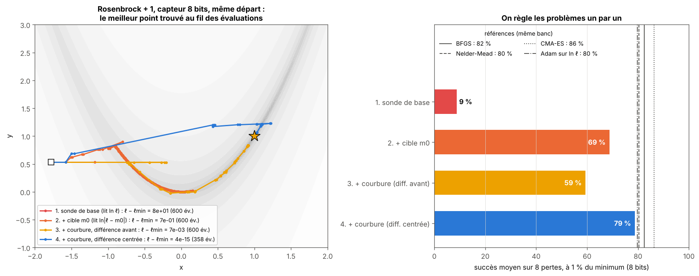
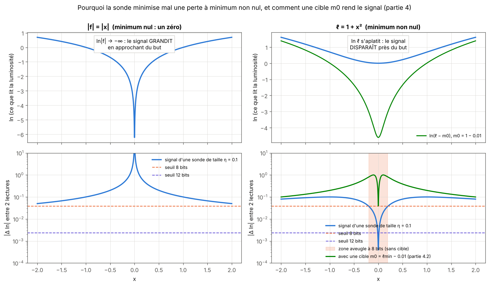
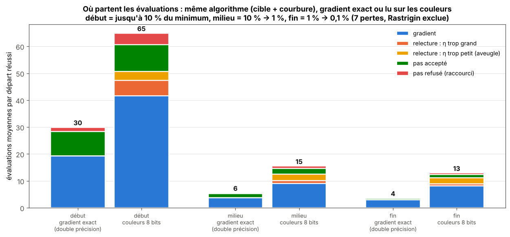
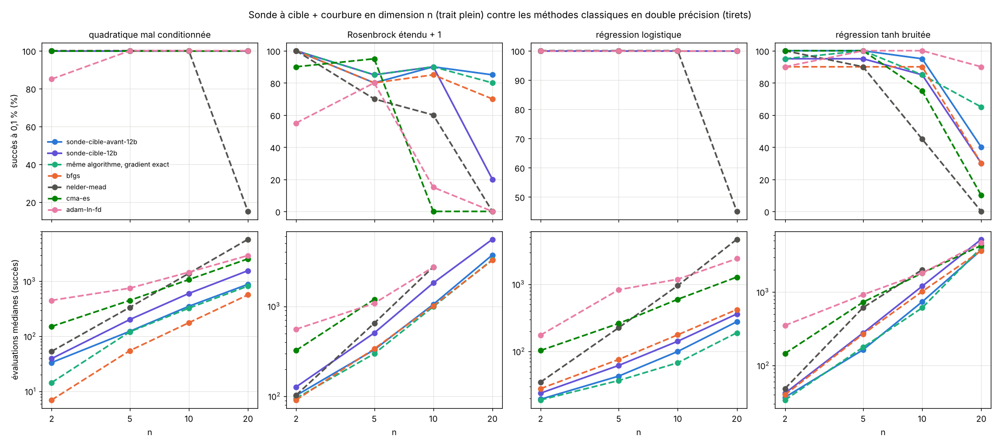
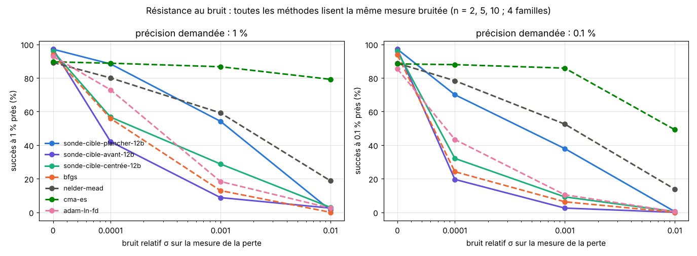

# Partie 4 : minimiser une perte ordinaire (minimum non nul)

> **En bref.** On règle les problèmes un par un. (1) La sonde de base échoue sur une perte dont le minimum n'est pas nul : 9 % de succès à 1 % près, car `ln ℓ` s'aplatit et le capteur ne voit plus rien. (2) Avec une **cible** `m0` qu'on abaisse en route, on lit `ln|ℓ − m0|`, qui plonge comme pour un vrai zéro : 69-70 %. (3) Il manque alors la **courbure** : on construit une approximation BFGS à partir des gradients lus sur les couleurs, à condition de lire ces gradients par **différence centrée**. On arrive à 79-80 %, au niveau de BFGS (82 %) et de Nelder-Mead (80 %), mais en 1,2 à 9 fois plus d'évaluations que BFGS en double précision. (4) Le diagnostic du coût (4.4) montre que ce surcoût vient surtout du prix d'un gradient lu en couleur ; en réutilisant le point du pas précédent, la sonde 12 bits a le succès de BFGS pour 1,3 à 1,5 fois son coût. (5) En dimension n (4.5), en lisant le gradient par différence avant à 12 bits (n lectures), elle a le succès de BFGS à toutes les tailles testées (jusqu'à n = 20) pour 1,2 à 2 fois son coût. (6) Face au bruit de mesure (4.6), un plancher de cible en fait la méthode à gradient la plus robuste, mais CMA-ES reste bien meilleur dès 0,1 % de bruit.

*À gauche : sur Rosenbrock + 1 avec le capteur 8 bits, la sonde de base reste bloquée, la cible avance mais suit la vallée lentement, la courbure (différence avant) s'arrête près du but, la courbure avec différence centrée atteint le minimum. À droite : succès moyen sur les 8 pertes à chaque étape, comparé aux méthodes classiques sur le même banc.*

*En haut : ce que lit la luminosité ; en vert, ce qu'elle lit avec une cible `m0` juste sous le minimum. Pour un zéro (`|x|`), `ln` plonge vers −∞. Pour une perte `1 + x²`, `ln` s'aplatit. En bas : variation lue par une sonde de taille 0,1. Près d'un zéro elle grandit, près d'un minimum non nul elle tombe sous le seuil du capteur : la zone orange est la zone aveugle à 8 bits. Avec la cible (vert), le signal remonte d'un facteur ~100 et la zone aveugle se réduit à un voisinage minuscule du minimum.*

Question : sur une perte ordinaire, dont le minimum n'est pas zéro, la sonde bat-elle Adam, BFGS, etc. ?

## 4.1 La sonde de base

### Protocole
- 8 pertes réelles en 2D, minimum non nul : quadratique mal conditionnée (+1 et +100), Rosenbrock+1, Himmelblau+1, Beale+1, Rastrigin+1, régression logistique (80 points bruités), ajustement exp(-bt) sur données bruitées.
- Capteur : couleur de F(z)=l(x,y)+0j. La sonde ne lit que ln l modulo une décade, quantifié (8 ou 12 bits).
- Coût = évaluations de l, budget 600, 40 départs, une graine. Succès : (l − lmin)/lmin < tol, tol = 0,1 / 0,01 / 0,001.
- Réglage du pas/lr sur d'autres départs pour Adam, CMA-ES et la sonde (3 à 5 valeurs). Classiques avec gradient par différences finies.
- Code : `parties/4_pertes_minimum_non_nul/bench_loss.py`, tableaux : `bench_loss_tables.md`.

### Résultat (succès moyen sur les 8 pertes)
| méthode | tol 0,1 | tol 0,01 | tol 0,001 |
|---|---|---|---|
| CMA-ES | 88 | 86 | 86 |
| Powell / BFGS / Nelder-Mead | 80–83 | 79–82 | 79–82 |
| Adam sur ln l | 83 | 80 | 70 |
| Adam sur l | 72 | 65 | 59 |
| GD (Armijo) | 67 | 56 | 49 |
| sonde 8 bits | 24 | 9 | 2 |
| sonde 12 bits | 23 | 8 | 2 |

**La sonde est nettement moins bonne** pour minimiser une perte à minimum non nul. Elle ne réussit un peu que sur la quadratique +100 et la régression logistique (à tolérance large).

### Pourquoi (en partie vérifié)
1. Le capteur ne donne que ln l modulo une décade, avec une résolution relative d'environ 3,8 % (8 bits) ou 0,23 % (12 bits). Près d'un minimum non nul, l varie moins que cela : la sonde ne voit plus rien. C'est la limite que prédit le calcul, et les échecs à tol 0,01 et 0,001 vont dans ce sens.
2. Sur les zéros, ln|f| tend vers −∞ : le signal grandit à l'approche du but. Ici il s'aplatit. L'avantage de la sonde (pas normalisé, invariance d'échelle) disparaît.
3. Sans zéro, il n'y a plus de dérivée complexe utile : elle se réduit à un gradient fini de ln l, obtenu à partir de lectures quantifiées. C'est un gradient par différences finies avec du bruit de quantification.

### Réserves
- Ma sonde pour les pertes est une variante écrite rapidement (gradient sur 3 lectures, pas avec recul sur la luminosité), testée avec 3 pas initiaux seulement. Elle échoue déjà à tol 0,1 sur la quadratique (10 %), ce qui peut aussi venir de ma conception et pas seulement du capteur. Une version meilleure est possible, mais l'argument 1 limite la précision dans tous les cas.
- Une graine, 40 départs, espace 2D uniquement.

## 4.2 La sonde à cible

**Idée.** On ne minimise plus `ℓ`, on cherche un zéro de `g = ℓ − m0`, avec une cible `m0` (« minimum supposé ») un peu sous la perte courante. Le logarithme `ln|g|` plonge alors vers −∞ à l'approche de `m0`, comme pour un vrai zéro, et la variation lue par une sonde vaut à peu près `η·|∇ℓ| / (ℓ − m0)` : elle **grandit** quand l'écart diminue. Quand on atteint le niveau `m0`, on abaisse la cible (`m0 ← m0 − ε`), et ainsi de suite jusqu'au minimum.

**Ce que fait l'algorithme** (`bench_loss_cible.py`) :
- la cible est `m0 = ℓ(x) − δ` ;
- deux sondes lisent les couleurs de `ℓ − m0` et donnent `W = ∇ ln|ℓ − m0|` ;
- pas de Newton vers le niveau `m0` : `h = −W/|W|²`, c'est-à-dire `h = −(ℓ − m0)·∇ℓ/|∇ℓ|²` ;
- si la perte baisse, on accepte le pas, et la cible suivante est `δ` sous la nouvelle valeur ; sinon, la cible est sous le minimum (inatteignable) et on divise `δ` par 2. Si la sonde est aveugle avec `η` maximal, on divise aussi `δ` par 2, ce qui amplifie le signal.

Ce pas est connu : c'est le **pas de Polyak** avec une valeur cible (Polyak, 1969 ; voir aussi Hazan et Kakade, 2019, et Loizou et al., 2021). Ajuster la cible en route a aussi été étudié (Liu et al., *Accelerating Level-Value Adjustment for the Polyak Stepsize*). Ce qui est propre à l'étude : la cible sert aussi à rendre la mesure lisible, en amplifiant le signal lu près du minimum. Références : [`docs/REFERENCES.md`](../../docs/REFERENCES.md). Pour isoler l'effet de la couleur, on compare au même algorithme avec un gradient par différences finies en double précision (`polyak-fd`).

**Réserve.** Former `ℓ − m0` demande la *valeur* de `ℓ`, pas seulement sa couleur. C'est le cas pour une perte qu'on calcule soi-même ; la couleur sert alors de capteur quantifié de `ℓ − m0` pour estimer la direction.

**Résultats** (mêmes 8 pertes, mêmes 40 départs, même budget de 600 évaluations ; réglage du pas de sonde sur les mêmes départs de réglage ; les autres méthodes ne sont pas relancées). Succès moyen, en % :

| méthode | tol 0,1 | tol 0,01 | tol 0,001 |
|---|---|---|---|
| CMA-ES | 88 | 86 | 86 |
| BFGS / Powell / Nelder-Mead | 80-83 | 80-82 | 79-82 |
| Adam sur ln ℓ | 83 | 80 | 70 |
| **sonde à cible, 12 bits** | **75** | **70** | **69** |
| **sonde à cible, 8 bits** | **70** | **69** | **68** |
| Polyak à gradient exact (même schéma de cible) | 75 | 69 | 69 |
| Adam sur ℓ | 72 | 65 | 59 |
| GD (Armijo) | 67 | 56 | 49 |
| sonde de base, 8 bits | 24 | 9 | 2 |

Par perte, à 1 % près (succès, évaluations médianes), sonde à cible 8 bits : quadratique mal conditionnée 100 % (276), quadratique + 100 100 % (24), Himmelblau 100 % (52), régression logistique 100 % (28), ajustement exponentiel 100 % (77), Beale 45 % (140), Rosenbrock 5 %, Rastrigin 0 %. Tableau complet : [`bench_loss_tables.md`](bench_loss_tables.md).

**Ce qu'il faut en retenir.**
1. **L'idée règle le problème de la partie 4.1** : de 9 % à 69 %, et le succès ne s'effondre plus quand on demande plus de précision (68 % à 0,1 %, contre 2 % avant).
2. **La couleur ne coûte rien ici** : la sonde à cible fait autant que la même méthode avec un gradient exact en double précision (69-70 % contre 69 %).
3. **Elle reste derrière BFGS, Nelder-Mead et CMA-ES.** C'est une méthode du premier ordre : elle zigzague dans les vallées étroites (Rosenbrock 5 %) et paie cher le mauvais conditionnement (276 évaluations contre 7 pour BFGS sur la quadratique). Personne ne réussit Rastrigin (minima locaux).
4. **Face à Adam**, elle est meilleure qu'Adam sur `ℓ` (65 %) et à peu près au niveau d'Adam sur `ln ℓ` (80 % à 1 %, mais 70 % à 0,1 % contre 68 % pour la sonde), souvent pour beaucoup moins d'évaluations (régression logistique : 28 contre 138-376).
5. Une graine, 40 départs, 2D seulement.

**Suite possible.** Passer à Adam en fin de course n'aiderait pas sur les vallées (Adam y fait 20-78 %). Ce qui manque est la courbure : un pas quasi-Newton (type BFGS) construit à partir des gradients lus sur les couleurs serait la prochaine étape logique, puis la dimension n.

## 4.3 Ajouter la courbure

**Le problème restant.** La sonde à cible suit le gradient : elle zigzague dans les vallées (Rosenbrock + 1 : 5 %) et paie cher le mauvais conditionnement (276 évaluations contre 7 pour BFGS sur la quadratique).

**L'idée.** La cible sert à *lire*, un modèle quadratique sert à *avancer* (`bench_loss_cible_qn.py`) :
- comme `ℓ − m0 = δ` est connu, chaque lecture donne `ρ = exp(Δ couleur) = (ℓ(x + η eₖ) − m0)/δ`, donc la différence `ℓ(x + η eₖ) − ℓ(x) = δ(ρ − 1)` et le gradient `∇ℓ` ;
- on garde ces gradients d'un pas à l'autre et on construit une approximation de l'inverse de la hessienne par mise à jour **BFGS** ;
- pas quasi-Newton (pas de Polyak tant qu'aucune courbure n'est apprise), raccourci de moitié si la perte ne baisse pas ;
- la cible suivante est placée à la baisse qu'on vient d'obtenir. Près du minimum, cette baisse est de l'ordre de `ℓ − ℓmin`, donc la cible reste juste sous le minimum et le signal ne s'aplatit pas.

**Un piège rencontré en route.** La première version lisait le gradient par différence avant (2 lectures). Elle a fait **moins bien** que la sonde à cible sans courbure (59-68 % contre 69-70 %). Le diagnostic : la différence avant a un biais proportionnel à la courbure de `ℓ`, de quelques pour cent. C'est sans importance pour un pas de gradient, mais BFGS construit sa courbure à partir de *différences* de gradients, et ce biais la fausse dans les vallées. La différence **centrée** (4 lectures par gradient) supprime ce biais.

**Résultats** (mêmes 8 pertes, 40 départs, budget 600 ; réglage de la taille de sonde comme pour les autres). Succès moyen, en % :

| méthode | tol 0,1 | tol 0,01 | tol 0,001 |
|---|---|---|---|
| CMA-ES | 88 | 86 | 86 |
| BFGS (double précision) | 82 | 82 | 82 |
| même algorithme, gradient exact en double précision | 81 | 81 | 81 |
| **sonde à cible + courbure, différence centrée, 12 bits** | **80** | **80** | **80** |
| **sonde à cible + courbure, différence centrée, 8 bits** | **79** | **79** | **78** |
| Nelder-Mead | 80 | 80 | 80 |
| Adam sur ln ℓ | 83 | 80 | 70 |
| sonde à cible (4.2), 8 / 12 bits | 70 / 75 | 69 / 70 | 68 / 69 |
| sonde à cible + courbure, différence avant, 8 / 12 bits | 62 / 72 | 59 / 68 | 56 / 65 |
| sonde de base, 8 bits | 24 | 9 | 2 |

Par perte, à 1 % près (succès, évaluations médianes), différence centrée 8 bits contre BFGS : quadratique mal conditionnée 100 % (62) contre 100 % (7) ; Rosenbrock + 1 **88 % (171)** contre 100 % (94) ; Himmelblau 100 % (43) contre 100 % (22) ; régression logistique 100 % (28) contre 100 % (24) ; ajustement exponentiel 95 % (56) contre 100 % (37) ; Beale 48 % contre 60 % ; Rastrigin 0 % pour les deux.

**Ce qu'il faut en retenir.**
1. **La courbure ferme presque l'écart** : 79-80 %, contre 82 % pour BFGS et 80 % pour Nelder-Mead, et le succès ne baisse plus quand on demande 0,1 % de précision.
2. **La couleur ne coûte presque rien en succès** : le même algorithme avec un gradient exact fait 81 %.
3. **Elle coûte en évaluations** : 1,2 à 9 fois plus que BFGS en double précision (4 lectures par gradient au lieu de 2, et des gradients moins précis). C'est le prochain problème à régler.
4. Rastrigin (minima locaux) reste hors de portée, comme pour BFGS et Nelder-Mead.
5. Une graine, 40 départs, 2D seulement.

**Prochains problèmes, dans l'ordre.** Réduire le coût d'un gradient (réutiliser les lectures, comme la sonde-Broyden de la partie 3) ; passer en dimension n (le coût d'un gradient y croît avec n) ; tester sur le petit réseau de la partie 5.

## 4.4 Où partent les évaluations ?

Pour savoir quoi améliorer, on découpe chaque course en trois phases selon l'écart au minimum : **début** (jusqu'à 10 %), **milieu** (10 % → 1 %), **fin** (1 % → 0,1 %). On classe aussi chaque évaluation selon sa cause. Mêmes départs et réglages que 4.3, 7 pertes (Rastrigin exclue, personne ne la résout) ; l'oracle sert seulement à mesurer. Script : `diag_cout.py`, tableau : [`diag_cout_sonde-cible-qnc-8b.md`](diag_cout_sonde-cible-qnc-8b.md).

*Même algorithme (cible + courbure) avec un gradient exact en double précision, ou lu sur les couleurs (8 bits). Évaluations moyennes par départ réussi.*

| cause (couleurs, 8 bits) | début | milieu | fin | total |
|---|---|---|---|---|
| lecture du gradient (4 lectures par gradient) | 40,6 | 9,0 | 8,1 | 57,7 |
| relecture : η trop grand (bande enjambée, niveau franchi) | 5,8 | 1,1 | 0,8 | 7,7 |
| relecture : η trop petit (sonde aveugle) | 3,3 | 2,4 | 2,3 | 8,0 |
| pas accepté | 9,9 | 2,1 | 1,2 | 13,2 |
| pas refusé (raccourci) | 4,3 | 0,9 | 0,5 | 5,7 |
| **total** (avec le point de départ) | **65** | **15,5** | **13** | **93** |
| *même algorithme, gradient exact* | *30* | *6* | *4* | *39* |

**Réponses aux trois hypothèses.**
- **Au début, à cause d'un mauvais réglage de η ?** En partie seulement. Les relectures dues à η coûtent environ 9 évaluations sur 65 (14 %). L'essentiel du surcoût du début vient du prix d'un gradient : 4 lectures au lieu de 2.
- **Au milieu, à cause d'un mauvais choix de η ?** Un peu plus : 3,5 relectures sur 15,5 (23 %), surtout parce que la sonde devient aveugle.
- **À la fin, parce qu'on rejoint mal le minimum ?** Oui, c'est le plus gros surcoût *relatif* (13 contre 4, soit 3,6 fois). Deux causes. Il faut environ deux gradients au lieu d'un, car le gradient lu est moins précis près du minimum. Et la sonde est souvent aveugle : après un bon pas, le gradient a fortement diminué, et η, réglé sur l'ancien gradient, devient trop petit.

**Bilan du surcoût** (≈ 54 évaluations de plus que le gradient exact) : environ 32 viennent des 4 lectures par gradient, 15 des relectures de η, 4 des pas refusés, et seulement 2 d'itérations en plus. La couleur ne rend donc pas la méthode beaucoup plus lente en *itérations* : elle rend chaque itération plus chère.

**Ce qu'on a essayé pour réduire ce coût.**

| essai | idée | résultat | gardé ? |
|---|---|---|---|
| η × 4 au lieu de × 2 quand on relit | moins de relectures quand η est mal réglé | relectures 15,7 → 9,3 ; moyenne à 0,1 % : 91 → 86 évaluations (8 bits), 76 → 71 (12 bits) ; même succès | **oui** (variante `qnc4`) |
| 2 lectures, biais corrigé par la courbure apprise | différence avant moins `η·B_kk/2` | moins d'évaluations, mais le succès baisse (90 % → 81 % des départs) : la courbure apprise n'est pas assez précise pour corriger le biais | non |
| η prédit au nouveau point | régler η sur le gradient attendu `g + H⁻¹s` | effondrement (46 %) : η trop grand, la sonde enjambe le niveau | non |
| réutiliser le point du pas précédent | le long du dernier pas, le point d'où l'on vient est déjà connu : 1 lecture et une différence à pas inégaux (exacte à l'ordre 2) ; 2 lectures centrées dans l'autre direction. **3 lectures par gradient au lieu de 4** | moyenne à 0,1 % : 86 → 79 évaluations (8 bits), 71 → 61 (12 bits) ; succès 81 % (comme le gradient exact) | **oui** (variante `qnc3`) |

Après réglage complet, à 0,1 % près (succès ; évaluations médianes ; moyenne) :

| méthode | 8 bits | 12 bits |
|---|---|---|
| cible + courbure, différence centrée (`qnc`, 4.3) | 78 % ; 57 ; 91 | 80 % ; 43 ; 76 |
| + η × 4 aux relectures (`qnc4`) | 79 % ; 54 ; 86 | 80 % ; 41 ; 71 |
| + réutilisation du point précédent (`qnc3`) | **81 % ; 49 ; 79** | **81 % ; 37 ; 61** |
| *même algorithme, gradient exact* | *81 % ; 25 ; 42* | |
| *BFGS (double précision)* | *82 % ; 28 ; 40* | |
| *Nelder-Mead (double précision)* | *80 % ; 52 ; 62* | |

**Résultat** : la sonde à cible + courbure (`qnc3`, 12 bits) a le taux de succès de BFGS et du gradient exact, coûte moins que Nelder-Mead, et environ 1,3 fois (médiane) à 1,5 fois (moyenne) plus que BFGS en double précision. L'écart restant vient du prix d'un gradient lu en couleur (3 lectures contre 2).

## 4.5 En dimension n

La méthode est écrite une fois pour toutes dans [`src/sonde_cible.py`](../../src/sonde_cible.py) : cible, courbure BFGS, η × 4 aux relectures, réutilisation du point précédent. Un gradient coûte 2n − 1 lectures (2n pour le premier), contre n pour une différence finie avant classique. Vérification : sur le banc 2D, elle redonne les chiffres de 4.4 (81 % ; 38 évaluations médianes à 12 bits).

**Banc** (`bench_loss_nd.py`) : 4 familles de pertes à minimum non nul, n = 2, 5, 10, 20 : quadratique mal conditionnée (valeurs propres de 1 à 100), Rosenbrock étendu + 1, régression logistique (200 points bruités), régression `tanh` bruitée (non convexe). Budget 300·n évaluations, 20 départs, réglage sur 6 autres départs. Les méthodes classiques lisent la perte en double précision.

Succès à 0,1 % près, moyenne sur les 4 familles ; entre parenthèses, évaluations médianes divisées par n. Détail par famille : [`bench_loss_nd_tables.md`](bench_loss_nd_tables.md).

| méthode | n = 2 | n = 5 | n = 10 | n = 20 |
|---|---|---|---|---|
| **sonde à cible, 12 bits** | **99 % (20)** | **95 % (40)** | **94 % (64)** | **62 % (75)** |
| sonde à cible, 8 bits | 96 % (42) | 86 % (74) | 91 % (108) | 52 % (126) |
| même algorithme, gradient exact | 99 % (12) | 96 % (24) | 94 % (35) | 86 % (42) |
| BFGS | 98 % (14) | 92 % (17) | 94 % (20) | 75 % (28) |
| Nelder-Mead | 100 % (26) | 90 % (72) | 76 % (133) | 15 % (255) |
| CMA-ES | 98 % (74) | 99 % (101) | 69 % (105) | 52 % (115) |
| Adam sur ln ℓ | 82 % (178) | 95 % (172) | 79 % (148) | 72 % (146) |

**Ce qu'il faut en retenir.**
1. **Jusqu'à n = 10, la sonde à 12 bits a le succès de BFGS** (94-99 %) et fait mieux que Nelder-Mead, CMA-ES et Adam en succès comme en coût.
2. **Elle coûte 1,5 à 3 fois plus que BFGS** (40 contre 17 évaluations par dimension à n = 5, 64 contre 20 à n = 10). C'est attendu : un gradient lu en couleur coûte 2n − 1 lectures au lieu de n.
3. **Exception : la régression logistique**, où la sonde est moins chère que BFGS à toutes les tailles (362 évaluations contre 421 à n = 20). La cible y fait mieux que la recherche linéaire de BFGS.
4. **À n = 20, elle décroche** (62 %) : sur Rosenbrock (20 %) et la régression `tanh` (30 %), le budget de 6 000 évaluations ne suffit plus au prix d'un gradient. Le même algorithme avec un gradient exact tient à 86 %, mieux que BFGS (75 %) : **la méthode est bonne, c'est la lecture du gradient qui coûte.**
5. **8 bits** coûte environ deux fois plus que 12 bits en dimension n (gradients plus bruités, plus de relectures).
6. Une graine, 20 départs ; minimum de la régression `tanh` estimé par 20 départs de BFGS (il peut exister mieux).

### 4.5.1 Moins de lectures par gradient

Le diagnostic est clair : en dimension n, c'est le prix d'un gradient qui coûte. Deux essais.

- **Lire quelques directions et prédire les autres avec le modèle BFGS** (`partiel=k` dans `src/sonde_cible.py`) : écarté. Le succès s'effondre (6-38 % à n = 5-20). Comme en 2D, la courbure apprise n'est pas assez précise pour prédire un gradient.
- **Différence avant** (`avant=True`) : une lecture par direction, plus le point réutilisé le long du dernier pas, soit **n lectures par gradient au lieu de 2n − 1**. En 2D la différence avant faussait la courbure (4.3). Avec les améliorations suivantes (point réutilisé, exact à l'ordre 2 le long du pas ; η × 4), elle tient **à 12 bits**. À 8 bits, la quantification la rend moins fiable (74-76 % en 2D contre 81 % avec la différence centrée).

Succès à 0,1 % près, moyenne sur les 4 familles (évaluations médianes divisées par n) :

| méthode | n = 2 | n = 5 | n = 10 | n = 20 |
|---|---|---|---|---|
| **sonde à cible, 12 bits, différence avant** | **100 % (17)** | **95 % (25)** | **96 % (40)** | **81 % (45)** |
| sonde à cible, 12 bits, différence centrée | 99 % (20) | 95 % (40) | 94 % (64) | 62 % (75) |
| sonde à cible, 8 bits, différence avant | 91 % (34) | 88 % (70) | 84 % (111) | 52 % (106) |
| même algorithme, gradient exact | 99 % (12) | 96 % (24) | 94 % (35) | 86 % (42) |
| BFGS (double précision) | 98 % (14) | 92 % (17) | 94 % (20) | 75 % (28) |

**Résultat** : à 12 bits, la sonde à cible a maintenant **un succès égal ou supérieur à celui de BFGS à toutes les tailles** (81 % contre 75 % à n = 20), pour **1,2 à 2 fois son coût**. En 2D, la même variante fait 81 % pour 29 évaluations médianes (46 en moyenne), contre 28 (40) pour BFGS.

**Prochain problème** : la résistance au bruit de mesure (4.6).

## 4.6 Résistance au bruit

**Le test** (`bench_loss_bruit.py`) : même banc qu'en 4.5 (4 familles, n = 2, 5, 10), mais chaque évaluation renvoie une valeur **bruitée** `ℓ̃ = ℓ·(1 + σε)`, avec un bruit relatif `σ` de 0 à 1 %. C'est la seule chose que voient **toutes** les méthodes. On règle aussi le pas de différence finie de BFGS et d'Adam. Le succès est mesuré sur la vraie valeur des points évalués.

Succès à 1 % près (moyenne sur 4 familles et 3 tailles ; évaluations médianes) :

| méthode | σ = 0 | σ = 10⁻⁴ | σ = 10⁻³ | σ = 10⁻² |
|---|---|---|---|---|
| sonde à cible 12 bits, différence avant | 97 % (103) | 42 % (34) | 9 % (19) | 2 % |
| sonde à cible 12 bits, différence centrée | 96 % (132) | 57 % (82) | 29 % (43) | 3 % |
| **sonde à cible 12 bits, centrée + plancher** | **97 % (134)** | **88 % (137)** | **54 % (142)** | 1 % (22 % avec un plancher plus haut) |
| BFGS (pas réglé) | 94 % (100) | 56 % (55) | 13 % (29) | 0 % |
| Adam sur ln ℓ (pas réglés) | 93 % (667) | 73 % (715) | 18 % (360) | 2 % |
| Nelder-Mead | 89 % (282) | 80 % (266) | 59 % (126) | 19 % (44) |
| CMA-ES | 90 % (375) | 89 % (369) | **87 % (350)** | **79 % (322)** |

**Premier constat** : le bruit casse toutes les méthodes qui estiment un gradient, la sonde comme BFGS et Adam. La cause, pour la sonde, est que la cible se rapproche de la perte courante, donc les différences lues deviennent plus petites que le bruit.

**Correction : un plancher de cible.** La cible ne descend jamais à moins de `q·|ℓ|` sous la perte courante, avec `q` réglé comme on règle le pas de différence finie de BFGS (`plancher` dans `src/sonde_cible.py`). C'est l'équivalent, pour la sonde, du pas de différence finie adapté au bruit de Berahas, Byrd et Nocedal (voir [`docs/REFERENCES.md`](../../docs/REFERENCES.md)).

**Ce qu'il faut en retenir.**
1. Avec le plancher, la sonde devient **la plus robuste des méthodes à gradient** : 88 % contre 56 % pour BFGS à σ = 10⁻⁴, et 54 % contre 13 % à σ = 10⁻³.
2. Elle reste **loin derrière CMA-ES** dès σ = 10⁻³ (87 %), et s'effondre à σ = 10⁻² (22 % au mieux, avec un plancher de 10 à 50 %).
3. Une partie de l'avantage de CMA-ES vient du critère : le succès compte n'importe quel point évalué, et CMA-ES évalue beaucoup de points près du minimum, même s'il ne peut pas savoir lequel est le bon sous le bruit. Le critère est le même pour toutes les méthodes, mais il favorise les méthodes à population.
4. Le plancher est réglé à la main, comme le pas de BFGS. L'estimer depuis les mesures (méthode ECnoise de Moré et Wild) serait la suite.
5. Une graine, 20 départs, un seul modèle de bruit (relatif, gaussien, indépendant).

## Conclusion
La sonde de base n'est pas faite pour les pertes à minimum non nul. En réglant les problèmes un par un (une cible qu'on abaisse, une courbure apprise sur des gradients lus proprement, puis moins de lectures par gradient), elle atteint le taux de succès de BFGS avec un capteur de 12 bits jusqu'à la dimension 20. Elle reste 1,2 à 2 fois plus chère que BFGS en double précision.
