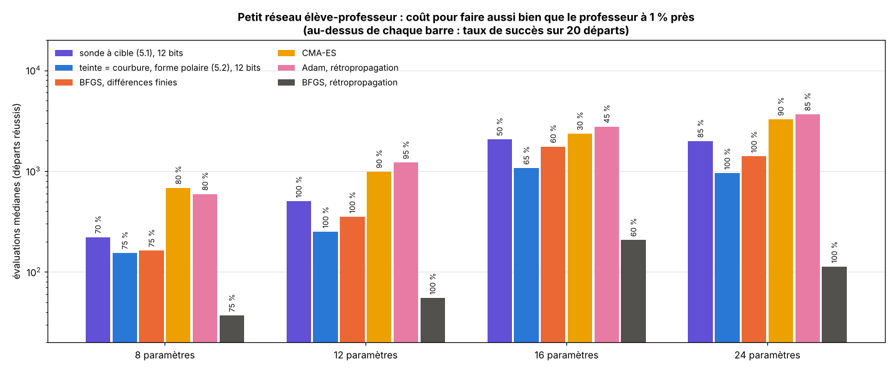

# Partie 5 : entraîner un petit réseau, et faire travailler la teinte

> **En bref.**
> - **5.1** La sonde à cible de la partie 4, telle quelle, sur la perte usuelle d'un petit réseau. Elle fait presque aussi bien que BFGS en boîte noire (76 % de succès contre 84 %) pour un coût comparable. Ici la couleur n'est qu'un capteur logarithmique : la teinte ne sert à rien.
> - **5.2** La teinte lit la **courbure**, dans la même lecture que la pente. Avec la forme polaire `|ℓ − m0|·exp(−iλD)`, la sonde fait 85 % de succès (BFGS par différences finies : 84 %), avec **30 à 52 % d'évaluations en moins** qu'en 5.1, et moins que BFGS par différences finies à toutes les tailles.
> - **5.3** La teinte lit la **perte de validation** : `ℓ_ent·exp(i·ln ℓ_val)` donne la courbe de validation presque exactement, et l'arrêt précoce lu dans la couleur fait aussi bien qu'avec les vraies valeurs.
> - **5.4** Les deux à la fois : 32 % d'évaluations en moins jusqu'au point retenu, et une validation un peu meilleure.
> - Dans tous les cas, BFGS avec rétropropagation reste 6 à 18 fois moins cher : l'intérêt est en boîte noire (on voit les sorties du réseau, pas son gradient), pas en apprentissage profond.

Deux essais qui n'ont pas abouti (deux pertes redondantes dans un nombre complexe ; poids complexes holomorphes lus en couleur) sont décrits dans [`fausses-pistes/`](../../fausses-pistes/).

## Le réseau et la perte

- **Réseau** (élève et professeur, même architecture) : 2 entrées → `h` neurones `tanh` → 1 sortie linéaire sans biais, soit `m = 4h` paramètres réels (`h = 2, 3, 4, 6` → 8, 12, 16, 24).
- **Données** : 100 points d'entrée gaussiens ; cibles `yᵢ` = sortie du professeur (poids tirés au hasard) + bruit gaussien d'écart-type 0,1.
- **Perte usuelle** : `ℓ(θ) = (1/100) Σᵢ (réseau_θ(xᵢ) − yᵢ)²`. À cause du bruit, elle ne descend pas à zéro : c'est le cadre « minimum non nul » de la partie 4.
- **Critère** : **faire aussi bien que le professeur**, `(ℓ − ℓ*)/ℓ* < tol`, où `ℓ*` est la perte du professeur. On ne vise pas le minimum global : un réseau assez grand descend sous `ℓ*` en apprenant le bruit, ce qui n'a pas de sens en apprentissage. (Avec le meilleur minimum de 40 départs de BFGS comme critère, *toutes* les méthodes tombaient à 5 % de succès à 24 paramètres.)
- **Coût** : évaluations de la perte ; un gradient exact (rétropropagation) compte pour une évaluation de plus. Budget 300·m, 20 départs, réglage sur 6 autres départs.

*Évaluations médianes pour faire aussi bien que le professeur à 1 % près, et taux de succès. La teinte (bleu) fait baisser le coût de la sonde (violet) sous celui de BFGS par différences finies (orange). La rétropropagation (gris) reste hors d'atteinte.*

## 5.1 La sonde à cible telle quelle

Code : `bench_net_cible.py` ; tableaux complets : [`bench_net_cible_tables.md`](bench_net_cible_tables.md).

Succès à 1 % près (évaluations médianes) :

| méthode | 8 param. | 12 param. | 16 param. | 24 param. | moyenne |
|---|---|---|---|---|---|
| sonde à cible, 12 bits | 70 % (222) | 100 % (502) | 50 % (2058) | 85 % (1982) | 76 % |
| sonde à cible, 8 bits | 70 % (307) | 90 % (1212) | 15 % (3307) | 70 % (3486) | 61 % |
| même algorithme, gradient exact | 70 % (235) | 100 % (454) | 70 % (2382) | 100 % (2164) | 85 % |
| BFGS, différences finies | 75 % (163) | 100 % (352) | 60 % (1752) | 100 % (1401) | 84 % |
| **BFGS, rétropropagation** | 75 % (37) | 100 % (55) | 60 % (207) | 100 % (113) | 84 % |
| Adam, rétropropagation | 80 % (593) | 95 % (1213) | 45 % (2763) | 85 % (3651) | 76 % |
| Adam, différences finies sur ln ℓ | 80 % (1423) | 100 % (1126) | 50 % (2100) | 90 % (4764) | 80 % |
| CMA-ES | 80 % (683) | 90 % (985) | 30 % (2344) | 90 % (3268) | 72 % |
| Nelder-Mead | 45 % (1242) | 70 % (1570) | 0 % | 25 % (5946) | 35 % |

La sonde à cible se comporte sur un réseau comme une méthode de boîte noire du niveau de BFGS par différences finies (un peu moins de succès, coût proche), et mieux que CMA-ES et Nelder-Mead. Mais on lit la couleur d'un nombre **réel** : la teinte ne porte rien. Toute la suite cherche quoi mettre dans la partie imaginaire.

## Une lecture, deux informations

Une lecture de la couleur de `F` donne le **rapport complexe** entre deux points, donc la variation de deux quantités pour le prix d'une. Si la seconde se calcule dans le même passage avant que la perte, elle est gratuite. Deux candidates : la courbure (5.2) et la perte de validation (5.3).

## 5.2 La teinte lit la courbure

*Calculé sur un vrai réseau de 12 paramètres. A : le long de deux directions, la perte descend, mais l'une est bien plus courbée. B : la couleur lue le long de chaque direction ; la teinte tourne de 5° dans la direction plate, de 115° dans la direction courbée. C : le rapport lu `ρ` ; son module donne la pente, son angle la courbure.*

**Idée.** On appelle `D(θ)` la **distance de prédiction** au point courant `x` : la moyenne des `(sortie_θ(xᵢ) − sortie_x(xᵢ))²`. Elle est gratuite, il suffit de garder les sorties du point courant. On lit la couleur de

`F = |ℓ − m0| · exp(−i·λ·D)`  (forme polaire).

- La luminosité ne lit que la perte : `ℓ(x + ηe) − ℓ(x) = δ(|ρ| − 1)`, comme en partie 4.
- La teinte ne lit que la distance : `Δteinte = −λD`, et `D ≈ η²·eᵀ(JᵀJ/N)e`.
- Or `2JᵀJ/N` est la hessienne de Gauss-Newton de l'erreur quadratique : **la teinte lit la courbure dans la direction sondée, avec la même lecture que la pente.**
- Vérification : la courbure lue correspond à la diagonale de Gauss-Newton à quelques pour cent près (rapports 0,95 à 1,25 sur 12 paramètres).

Une première version utilisait la forme cartésienne `F = (ℓ − m0) + i·λ·D`. La forme polaire sépare les deux canaux : la distance ne fait plus déborder la luminosité. Une précaution est nécessaire : `D` varie comme `η²`, donc on garde `λη²` fixe quand `η` change ; sans cela la teinte fait plus d'un demi-tour et la sonde se trompe de diagnostic (jusqu'à 1 000 relectures par course).

Code : `sonde_cible_teinte` dans [`src/sonde_cible.py`](../../src/sonde_cible.py) ; banc : `bench_net_teinte.py` (mêmes réseaux, départs et critère que 5.1).

| variante (12 bits) | 8 param. | 12 param. | 16 param. | 24 param. | moyenne |
|---|---|---|---|---|---|
| cartésienne, courbure diagonale, λ réglé sur la médiane | 35 % (181) | 55 % (692) | 10 % (1446) | 80 % (2006) | 45 % |
| cartésienne, courbure diagonale, λ réglé sur la direction la plus courbée | 80 % (216) | 95 % (394) | 25 % (1140) | 95 % (1709) | 74 % |
| cartésienne, courbure lue mais non utilisée | 70 % (236) | 100 % (525) | 45 % (2585) | 100 % (2226) | 79 % |
| cartésienne, échelle de la courbure seulement | 85 % (157) | 95 % (275) | 55 % (1631) | 95 % (1036) | 82 % |
| **polaire, échelle de la courbure** | **75 % (155)** | **100 % (250)** | **65 % (1072)** | **100 % (954)** | **85 %** |
| polaire, courbure diagonale | 90 % (178) | 95 % (327) | 30 % (1302) | 95 % (1157) | 77 % |
| polaire, 8 bits, échelle de la courbure | 45 % (229) | 70 % (290) | 0 % | 25 % (1473) | 35 % |
| *rappel : sonde à cible 5.1* | *70 % (222)* | *100 % (502)* | *50 % (2058)* | *85 % (1982)* | *76 %* |
| *rappel : BFGS, différences finies* | *75 % (163)* | *100 % (352)* | *60 % (1752)* | *100 % (1401)* | *84 %* |

**Deux problèmes réglés en route.**
1. **Teinte saturée** : avec λ réglé sur la courbure médiane, la direction la plus courbée faisait déborder la teinte (jusqu'à 200 relectures par course). On règle donc λ sur la direction la plus courbée.
2. **Courbure diagonale trompeuse** : les paramètres d'un réseau sont fortement couplés, et une hessienne diagonale propose de mauvais pas (jusqu'à 120 pas refusés par course à 16 paramètres). On ne garde que **l'échelle** de la courbure (la médiane des courbures lues) pour régler le premier pas ; BFGS apprend ensuite les couplages.

**Ce qu'il faut en retenir.**
- En forme polaire, la sonde gagne **30 à 52 % d'évaluations** sur 5.1 (155 contre 222, 250 contre 502, 1 072 contre 2 058, 954 contre 1 982), avec plus de succès (85 % contre 76 %). Elle a le succès de BFGS par différences finies et coûte moins que lui à toutes les tailles.
- C'est le premier résultat où la teinte apporte un gain mesurable sur une perte ordinaire.
- À 8 bits, la teinte n'est plus assez fine pour lire la courbure (35 %).
- Une graine, 20 départs ; la vérification de la courbure lue porte sur un seul point.

## 5.3 La teinte lit la perte de validation

**Idée.** On prend un réseau qui peut apprendre le bruit (24 paramètres, seulement 30 points d'entraînement, 200 de validation) et on l'entraîne avec la sonde à cible (12 bits) sur la perte d'entraînement. À chaque pas accepté, on lit la couleur d'un nombre qui contient aussi la perte de validation, calculée dans le même passage avant :

- forme cartésienne `F = ℓ_ent + i·ℓ_val` : la teinte `atan(ℓ_val/ℓ_ent)` **monte vers 90° quand l'écart de généralisation grandit**, et `ln ℓ_val = ln|F| + ln sin(teinte)` se reconstruit à partir des couleurs seules ;
- forme polaire `F = ℓ_ent·exp(i·ln ℓ_val)` : la teinte lit directement `ln ℓ_val`.

**Arrêt précoce lu en couleur** : on garde le pas de plus petite validation reconstruite, et on s'arrête après 40 pas sans amélioration. Code : `bench_net_validation.py`, figure : `bench_net_validation_figs.py`.

Perte de validation du point retenu (médiane sur 20 départs ; professeur : 0,0097) :

| point retenu | validation |
|---|---|
| dernier point, sans arrêt | 0,0368 |
| arrêt lu dans la couleur, forme cartésienne | 0,0197 |
| **arrêt lu dans la couleur, forme polaire** | **0,0197** |
| arrêt avec les vraies valeurs (même règle) | 0,0197 |
| meilleur point possible (oracle) | 0,0187 |

L'erreur de lecture de la courbe de validation (en logarithme) vaut 0,21 en forme cartésienne, où la luminosité doit être dépliée décade par décade, et **0,0003** en forme polaire.

L'arrêt précoce lu dans la couleur fait exactement aussi bien que celui qui lit les vraies valeurs, et divise par près de deux la perte de validation par rapport à un entraînement sans arrêt. L'arrêt précoce n'a rien de nouveau ; l'intérêt est la lisibilité : un coup d'œil à la teinte dit si le réseau sur-apprend.

## 5.4 Les deux à la fois

Une seule teinte ne peut pas porter à la fois la courbure et la validation. Mais un même passage avant peut être coloré **deux fois** : les lectures de sonde colorent `|ℓ − m0|·exp(−iλD)` (courbure, 5.2), les points acceptés colorent `ℓ_ent·exp(i·ln ℓ_val)` (validation, 5.3). Même montage que 5.3, mêmes départs.

| médianes sur 20 départs | sonde à cible + arrêt en couleur (5.3) | **courbure en teinte + arrêt en couleur** |
|---|---|---|
| perte de validation du point retenu | 0,0197 | **0,0184** |
| évaluations jusqu'au point retenu | 1 038 | **708** (−32 %) |
| évaluations jusqu'au déclenchement de l'arrêt | 2 041 | **1 711** (−16 %) |

Les deux usages de la teinte se combinent sans se gêner : l'entraînement est plus économe, et l'arrêt précoce choisit un point au moins aussi bon.

## Limites

- Petits réseaux (8 à 24 paramètres), une graine, 20 départs.
- Avec la rétropropagation, BFGS reste 6 à 18 fois moins cher : la méthode n'a pas d'intérêt pratique quand le gradient est disponible.
- La courbure en teinte demande 12 bits.
