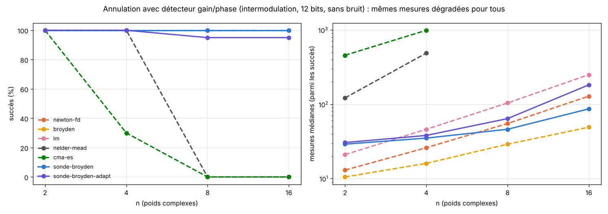
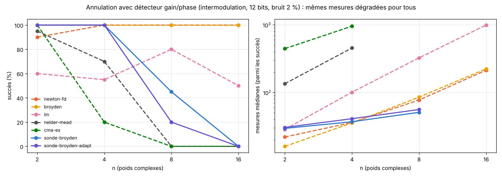

# Partie 6 : à armes égales

> **En bref.** Pour savoir si la sonde est *utile*, on la met dans une situation physique où l'on ne dispose que d'un détecteur gain/phase quantifié et bruité, et **on donne exactement les mêmes mesures dégradées aux méthodes classiques**. Résultat : sans bruit et à 12 bits, la sonde-Broyden est fiable mais Broyden classique reste moins cher. Avec du bruit, la sonde perd en fiabilité dès `n = 8`, alors que Newton et Broyden à jacobien estimé tiennent. Elle n'est la moins chère que dans une petite fenêtre (cas linéaire, bruit faible, `n = 16`). **Ce cas d'usage ne montre pas d'avantage.**

## Le problème

On règle `n` poids complexes `w` (un réseau d'antennes, une chaîne de calibration) pour **annuler** la réponse mesurée sur `n` récepteurs : trouver `w` tel que `F(w) = 0`, avec

- `F(w) = u` (cas **linéaire**) ou `F(w) = u + 0,05·u³` (**intermodulation**, non linéaire), où `u = H w − b`, `H` aléatoire proche de l'identité ;
- départ aléatoire dans `[−3, 3]` (parties réelle et imaginaire), 20 départs, `n = 2, 4, 8, 16`, budget `max(1000, 100 n)` mesures.

Le **seul accès à F** est un détecteur gain/phase, l'équivalent physique de la couleur :
- bruit multiplicatif `exp(σ g₁ + iσ g₂)` sur chaque composante, `σ ∈ {0 ; 0,5 % ; 2 %}` ;
- la **sonde** lit la couleur (luminosité = `ln|F|` à une décade près, teinte = phase) sur 8 ou 12 bits ;
- les **méthodes classiques** lisent un détecteur logarithmique **non périodique** de même résolution (pas de `ln|F|` et de phase identiques à ceux du capteur couleur). Elles ont donc en plus l'échelle absolue. Leur pas de différence finie est réglé sur d'autres départs (0,03 à 1).

Succès : `max|Fᵢ| < 10⁻³` sur la **vraie** valeur, que personne ne voit.

## Ce que la comparaison précédente cachait

Dans la partie 3 (y compris la comparaison en boîte noire), les méthodes classiques lisaient `F` en double précision avec un pas de différence finie de `10⁻⁶`. Ici, avec ce pas, Newton-FD, Broyden et LM tombaient à **0 %** : la quantification noie la différence. Une fois le pas réglé, ils redeviennent excellents. Il fallait donc tester les deux à armes égales.

## Résultats (12 bits, intermodulation)

Tableaux complets (2 familles × 3 niveaux de bruit × 8 et 12 bits) : [`bench_usecase_tables.md`](bench_usecase_tables.md). Quelques lignes :

| cas | sonde-Broyden | Broyden classique | Newton-FD |
|---|---|---|---|
| linéaire, sans bruit, 12 bits, n = 16 | 100 % (47) | 100 % (25) | 100 % (69) |
| linéaire, bruit 0,5 %, 12 bits, n = 16 | **100 % (48)** | 100 % (70) | 100 % (69) |
| linéaire, bruit 2 %, 12 bits, n = 16 | 30 % (54) | 100 % (181) | 100 % (86) |
| intermodulation, sans bruit, 12 bits, n = 16 | 100 % (86) | 100 % (49) | 100 % (128) |
| intermodulation, bruit 2 %, 12 bits, n = 8 | 45 % (51) | 100 % (86) | 100 % (78) |

## Ce qu'il faut en retenir

1. **Sans bruit, à 12 bits**, la sonde-Broyden est aussi fiable que les meilleures (100 %) et moins chère que Newton-FD et LM à `n = 16` (et à `n = 8` en intermodulation), mais **Broyden classique est moins cher partout**. À 8 bits elle perd déjà en fiabilité en intermodulation (85 % à `n = 8`, 60 % à `n = 16`).
2. **Avec du bruit**, c'est le point faible : la sonde divise des lectures bruitées (`F(z+h)/F(z)`) et sa mise à jour de rang 1 accumule le bruit. Avec 2 % de bruit elle tombe à 25-45 % dès `n = 8` en intermodulation, et à 0-45 % pour `n = 16`. Newton-FD, avec un grand pas de différence finie, moyenne le bruit et reste à 90-100 %.
3. **Fenêtre favorable** : bruit faible (0,5 %), cas linéaire, `n = 16` : la sonde-Broyden est la moins chère (48 mesures contre 69-70).
4. Les **bits adaptatifs** n'aident pas ici : le problème est le bruit, pas la résolution.
5. Limites : une graine, 20 départs, un modèle de bruit simple, pas de dérive du gain.

## Où chercher un vrai avantage

Les méthodes classiques ont ici l'échelle absolue de `|F|`. La sonde n'en a pas besoin. Un avantage n'est donc à attendre que là où cette échelle **manque** ou **dérive** : gain du détecteur inconnu et variable dans le temps, détecteur qui sature ou se replie (lecture modulo une plage), mesures de phase seule. C'est la première piste de [`IDEES_A_EXPLORER.md`](../../IDEES_A_EXPLORER.md).

## Fichiers

- `bench_usecase.py` : le banc (≈ 12 min sur 1 cœur) ; `bench_usecase_figs.py` : tableaux et figures.
- `bench_usecase_results.json`, `bench_usecase_tables.md`, `figures/`.
